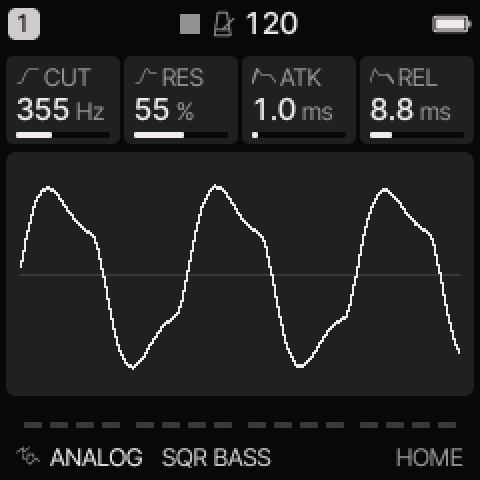
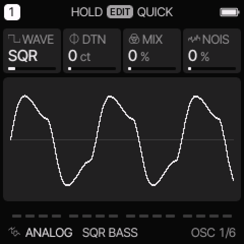
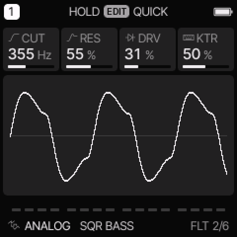

# ANALOG engine

[All engines](ENGINE_GUIDE.md) · [Modes and shared controls](MODE_GUIDE.md)

Use ANALOG for basses, leads, pads, and sounds shaped by a resonant filter.

## How the sound is made

Two oscillators and a noise source feed a filter. The envelope sets the note shape. Filter and shape modulation can change the tone while a note plays.

<figure>

<figcaption>ANALOG on HOME. These knobs apply to the selected track unless HOME LEVELS is enabled.</figcaption>
</figure>
## HOME knobs

| Knob 1 | Knob 2 | Knob 3 | Knob 4 |
| --- | --- | --- | --- |
| CUT | RES | ATK | REL |

For HOME LEVELS, see [HOME and mixer](MODE_GUIDE.md#home-and-mixer).

## Engine controls

Press the panel **EDIT** button to cycle the engine pages.
Pause between presses to avoid opening its shortcut layer.
The musical **EDIT key** is a different control.

### OSC page

<figure>

<figcaption>OSC is engine page 1.</figcaption>
</figure>
| Control | What it changes |
| --- | --- |
| WAVE | Select SAW, SQR, TRI, SIN, PWM, SYNC, or SUB. See the mode table below. |
| DTN / SYNC | Detune the second oscillator in cents. In SYNC, change its pitch above the first oscillator instead. |
| MIX / SUB | Mix the two oscillators. In SUB, increase the lower square oscillator. |
| NOIS | Add noise before the filter. |

### FLT page

<figure>

<figcaption>FLT is engine page 2.</figcaption>
</figure>
| Control | What it changes |
| --- | --- |
| CUT | Set the filter cutoff. A higher LP cutoff usually gives a brighter sound. |
| RES | Emphasize frequencies near the cutoff. |
| DRV | Add drive before the filter. |
| KTR | Make the cutoff follow the played pitch. Higher notes open the filter more. |

## Oscillator and filter modes

| WAVE | Use |
| --- | --- |
| SAW | Bright oscillator pair for basses, strings, and brass. |
| SQR | Square oscillator pair with a hollow tone. |
| TRI | Softer triangle oscillator pair. |
| SIN | Sine oscillator pair with few upper harmonics. |
| PWM | Pulse oscillator pair. Route LFO or ENV to SHP to move the pulse width. |
| SYNC | The first saw resets the second saw. Sweep SYNC or route modulation to SHP. |
| SUB | A saw with a square one octave below. SUB controls the lower oscillator level. |

On **EDIT > FILTER**, TYPE selects LP, BP, or HP.
LP removes high frequencies. BP keeps a band near the cutoff. HP removes low frequencies.

## Try these changes

### Hear a filter sweep

Load **303 SQUELCH**. Hold one note and turn CUT slowly. Increase RES, then lower it again. On ENV DEST, add a positive FLT amount to make each attack open the filter.

### Hear hard sync

Load **JUPITER SYNC**. Open OSC and change SYNC while holding a note. The note stays at its played pitch while its harmonic pattern changes.

## Factory presets

**SQR BASS**, **SAW LEAD**, **SOFT PAD**, **JUNO CHORUS**, **JUPITER SYNC**, **303 SQUELCH**, **MINI ROUND**, **MS REED**.

See the [inspired preset catalogue](INSPIRED_PRESETS.md) for the references behind the newer sounds.

## Limits and useful checks

ANALOG has no dedicated Jupiter-8 model. Its inspired presets use these oscillator, filter, envelope, and effect controls.

Save a user preset or project before loading another sound if you want to keep your edits.
