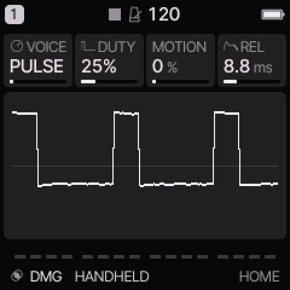
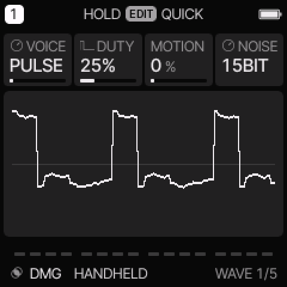
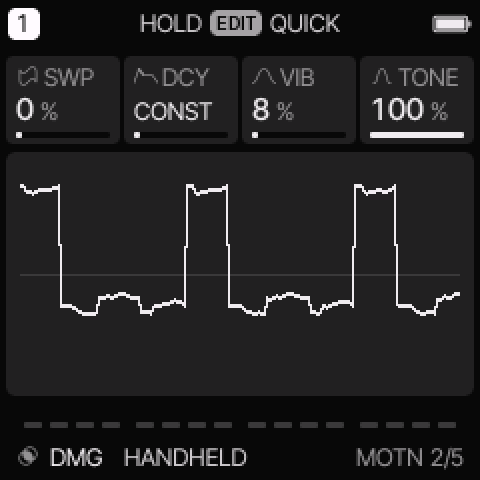
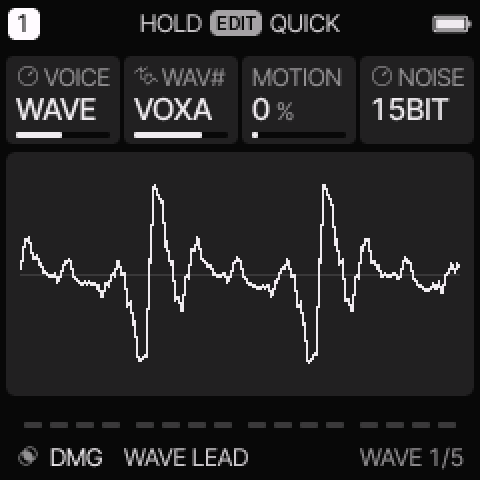

# DMG engine

[All engines](ENGINE_GUIDE.md) · [Modes and shared controls](MODE_GUIDE.md)

Use DMG for handheld pulse basses, four-bit wave tones, and short-register noise.

## How the sound is made

Each note uses a pulse, a fixed 32-position wave, or clocked noise. MOTION can step through the sixteen wave shapes. A stepped chip decay runs with the common envelope.

<figure>

<figcaption>DMG on HOME. These knobs apply to the selected track unless HOME LEVELS is enabled.</figcaption>
</figure>
## HOME knobs

| Knob 1 | Knob 2 | Knob 3 | Knob 4 |
| --- | --- | --- | --- |
| VOICE | DUTY / WAV# | MOTION | REL |

For HOME LEVELS, see [HOME and mixer](MODE_GUIDE.md#home-and-mixer).

## Engine controls

Press the panel **EDIT** button to cycle the engine pages.
Pause between presses to avoid opening its shortcut layer.
The musical **EDIT key** is a different control.

### WAVE page

<figure>

<figcaption>WAVE is engine page 1.</figcaption>
</figure>
| Control | What it changes |
| --- | --- |
| VOICE | Select PULSE, WAVE, or NOISE. |
| DUTY / WAV# | In PULSE, select pulse width. In WAVE, select one of sixteen wave shapes. |
| MOTION | In WAVE, advance through wave shapes. Higher settings advance faster. It does not scan the pulse width. |
| NOISE | Select 15BIT for a longer noise pattern or 7BIT for a shorter, more pitched pattern. |

### MOTN page

<figure>

<figcaption>MOTN is engine page 2.</figcaption>
</figure>
| Control | What it changes |
| --- | --- |
| SWP | Increase the downward pitch sweep. Very small settings have little or no effect. |
| DCY | Select constant volume, a stepped D decay, or a repeating L decay. |
| VIB | Increase the built-in pitch vibrato depth. |
| TONE | Set the output brightness. |

## Pulse, wave, and noise modes

PULSE has four widths: 12.5%, 25%, 50%, and 75%.
The saved width range has four adjacent values for each width.
On the device, the second control is labelled DUTY in PULSE and WAV# in WAVE.
Some editor views can show WAV# for this same control.

WAVE contains SQ50, SQ25, SQ12, SINE, TRI, SAW, SAW2, BAS1, BAS2, ORGN,
HOLW, VOXA, VOXO, VOXE, BUZZ, and STAIR.
These shapes use 32 samples with sixteen amplitude levels.
They are fixed built-in waves; this engine does not import custom wave RAM.

NOISE uses 15BIT or 7BIT feedback. 7BIT produces a shorter repeating pattern.

DCY uses the same CONST, D0–D15, and L1–L15 choices as NES.
Higher decay numbers give longer steps. DMG uses a slower decay clock.

<figure>

<figcaption>WAVE changes the second control from DUTY to WAV#.</figcaption>
</figure>

## Try these changes

### Hear wave motion

Load **WAVE LEAD**. Select WAVE. Set MOTION low, then increase it while holding a note. Compare this stepped change with WAVE engine scanning.

### Make a pitched noise hit

Load **7BIT TOM**. Compare 7BIT with 15BIT. Change SWP and DCY to adjust the falling attack and tail.

## Factory presets

**HANDHELD**, **WAVE LEAD**, **SHORT HIT**, **POCKET BASS**, **POCKET BELL**, **POCKET WIND**, **7BIT TOM**, **LINK LEAD**.

See the [inspired preset catalogue](INSPIRED_PRESETS.md) for the references behind the newer sounds.

## Limits and useful checks

DMG is handheld-inspired. Its controls do not emulate a complete Game Boy or its channel allocation.

Save a user preset or project before loading another sound if you want to keep your edits.
