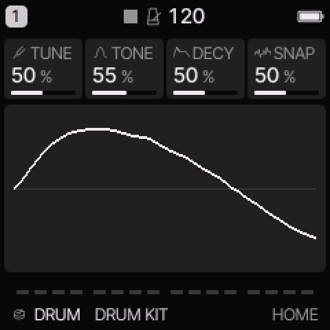
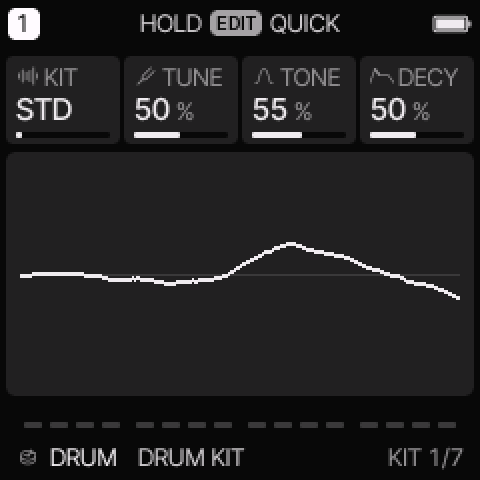
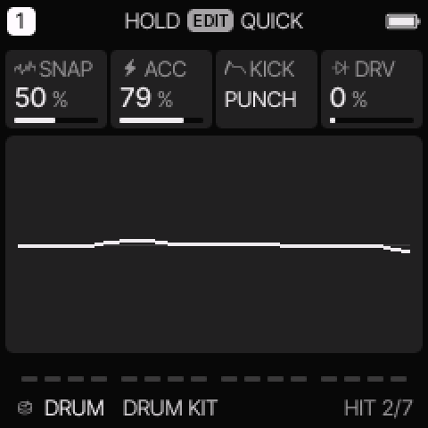

# DRUM engine

[All engines](ENGINE_GUIDE.md) · [Modes and shared controls](MODE_GUIDE.md)

Use DRUM for a complete synthesized kit on one track.

## How the sound is made

Eight lanes can ring together. Each lane owns a drum voice and a new hit on that lane retriggers it. The kick, snare, clap, hats, tom, rim, and bell use their own synthesis envelopes.

<figure>

<figcaption>DRUM on HOME. These knobs apply to the selected track unless HOME LEVELS is enabled.</figcaption>
</figure>
## HOME knobs

| Knob 1 | Knob 2 | Knob 3 | Knob 4 |
| --- | --- | --- | --- |
| TUNE | TONE | DECY | SNAP |

For HOME LEVELS, see [HOME and mixer](MODE_GUIDE.md#home-and-mixer).

## Engine controls

Press the panel **EDIT** button to cycle the engine pages.
Pause between presses to avoid opening its shortcut layer.
The musical **EDIT key** is a different control.

### KIT page

<figure>

<figcaption>KIT is engine page 1.</figcaption>
</figure>
| Control | What it changes |
| --- | --- |
| KIT | Select the kit model. Available choices include STD, 80, 10, 66, 55, 77, DEEP, TIGHT, and PERC. |
| TUNE | Tune the kit. The middle setting is the designed pitch; the range is approximately one octave down to one octave up. |
| TONE | Change the kit brightness. |
| DECY | Scale the drum decay times. Higher settings give longer tails. |

### HIT page

<figure>

<figcaption>HIT is engine page 2.</figcaption>
</figure>
| Control | What it changes |
| --- | --- |
| SNAP | Change each lane’s extra character: snare noise, clap spread, hat noise, tom bend, or related attack detail. |
| ACC | Set accent strength at full velocity. |
| KICK | On STD, choose PUNCH or ROUND. Model kits use their own kick variant. |
| DRV | Add soft clipping to drum hits. |

## Kit lanes and modes

EDIT > LANES and LANES 2 set the eight lane levels.
A lane level of 100% uses the kit's designed level.
A closed hat stops an open hat. Releasing a key does not stop a drum hit.

The current detailed tracker uses these short headers. Its standard lane assignments are:

| Header in this release | Standard lane | MIDI note |
| --- | --- | --- |
| KD | Kick | 36 |
| SD | Snare | 38 |
| CH | Clap | 39 |
| OH | Closed hat | 42 |
| LT | Open hat | 46 |
| HT | Tom | 45 |
| CP | Rim | 37 |
| RM | Bell | 56 |

Some kits substitute a cymbal, conga, or clave in a lane.
The header abbreviations are not a separate General MIDI map.

In detailed PHRASE, select a lane and tap the EDIT key to switch its hit on or off.
EDIT + UP adds accent. EDIT + DOWN removes accent.
NOTE mode can enter the drum hits whose physical keys are available.
Use lane editing for hits on keys reserved by the tracker controls.

The common ADSR, glide, and pitch/filter/shape modulation do not shape these one-shot drum voices.
Level, pan, effects, velocity, lane accents, and supported amplitude modulation still apply.

## Try these changes

### Balance a kit

Load **DRUM KIT**. Enter a few hits in detailed PHRASE. Use LANES and LANES 2 to lower the hats or clap without changing other lanes.

### Make a short electronic kit

Load **MINIMAL KIT**. Lower DECY, then increase SNAP slightly. Add DRV last and compare the level before saving.

## Factory presets

**DRUM KIT**, **DEEP KIT**, **TIGHT KIT**, **ELECTRO KIT**, **HOUSE KIT**, **ARCADE KIT**, **DUB KIT**, **MINIMAL KIT**.

See the [inspired preset catalogue](INSPIRED_PRESETS.md) for the references behind the newer sounds.

## Limits and useful checks

The drums are synthesized. Kit names do not add sampled 707 or DMX instruments. Up to eight lanes can sound on a part, but the total active voice budget across all tracks remains eight.

Save a user preset or project before loading another sound if you want to keep your edits.
