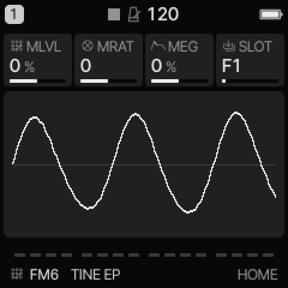
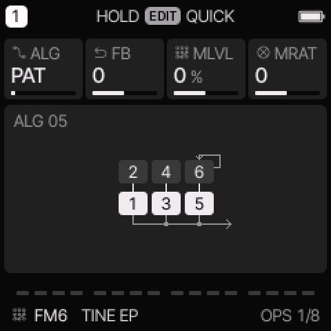
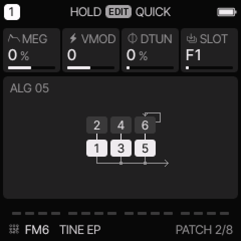

# FM6 engine

[All engines](ENGINE_GUIDE.md) · [Modes and shared controls](MODE_GUIDE.md)

Use FM6 for DX-style electric pianos, bells, brass, basses, and layered digital tones.

## How the sound is made

Six operators form the sound. An operator is an oscillator with its own envelope. Carriers reach the output; modulators change other operators. An algorithm connects them. A complete operator patch sits below eight performance controls.

<figure>

<figcaption>FM6 on HOME. These knobs apply to the selected track unless HOME LEVELS is enabled.</figcaption>
</figure>
## HOME knobs

| Knob 1 | Knob 2 | Knob 3 | Knob 4 |
| --- | --- | --- | --- |
| MLVL | MRAT | MEG | SLOT |

For HOME LEVELS, see [HOME and mixer](MODE_GUIDE.md#home-and-mixer).

## Engine controls

Press the panel **EDIT** button to cycle the engine pages.
Pause between presses to avoid opening its shortcut layer.
The musical **EDIT key** is a different control.

### OPS page

<figure>

<figcaption>OPS is engine page 1.</figcaption>
</figure>
| Control | What it changes |
| --- | --- |
| ALG | PAT uses the patch algorithm. Values 1–32 override it with another algorithm. |
| FB | Add to or subtract from the patch feedback. |
| MLVL | Raise or lower modulator levels. This usually changes brightness more than final loudness. |
| MRAT | Add to the coarse frequency ratios of modulators in ratio mode. |

### PATCH page

<figure>

<figcaption>PATCH is engine page 2.</figcaption>
</figure>
| Control | What it changes |
| --- | --- |
| MEG | Change modulator envelope speed. Positive amounts slow the envelopes; negative amounts speed them up. |
| VMOD | Change modulator velocity sensitivity. |
| DTUN | Spread the carrier pitches for a wider or beating sound. |
| SLOT | Load a built-in patch, the track’s OWN patch, or an available bank patch. |

## Patch and operator editing

The common track ADSR does not control FM6's note length.
Use its operator envelopes. A carrier envelope controls audible level.
A modulator envelope changes the evolving tone.

| EDIT page | Knobs 1–4 |
| --- | --- |
| OPERATOR | OP, CRS, FINE, LEVEL |
| OP ENV | OP, STAGE, RATE, LEVEL |
| OPERATOR 2 | OP, MODE, DTUN, VEL |

OP selects operator 1–6. CRS and FINE set its frequency.
RATIO follows the played note. FIXED sets a frequency independent of the played note.
Each operator envelope has four rates and four target levels.
Higher envelope rates move faster. Edit the release stage to change the tail.

Editing an operator makes the patch **OWN**.
Performance controls still apply above that patch.
Direct operator edits are saved with sounds and projects; they are not separate step-lock parameters.

In this Yanfei profile, the original three built-in SLOT patches are followed by OWN.
The five newer FM6 factory presets carry their full patch as OWN.
The full preset list still contains eight sounds.
OWN is not a fourth factory preset. Save it in a user preset or project to keep it.
The [web editor](WEB_EDITOR.md) can import and export DX-style SysEx voices.

## Try these changes

### Change an electric piano attack

Load **TINE EP**. Increase MLVL slightly and compare soft and hard playing. Return MLVL to zero before changing the underlying operator patch.

### Make a softer mallet

Load **DX MALLET**. Lower MLVL. For a longer tail, use OP ENV on the audible carriers; the common ENV release will not do this.

## Factory presets

**TINE EP**, **FM BASS**, **PAD**, **TX RUBBER**, **DX GLASS**, **DX MALLET**, **DX BRASS**, **DX ORGAN**.

See the [inspired preset catalogue](INSPIRED_PRESETS.md) for the references behind the newer sounds.

## Limits and useful checks

FM6 has at most six voices per track. It shares the total eight-voice budget with other tracks. Importing a patch replaces that track’s current operator patch.

Save a user preset or project before loading another sound if you want to keep your edits.
