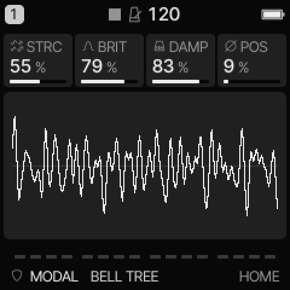
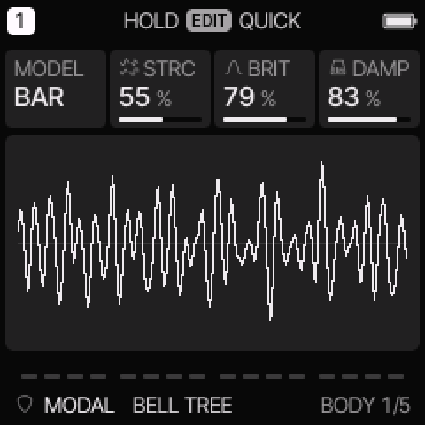
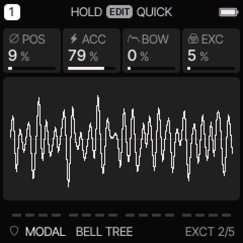
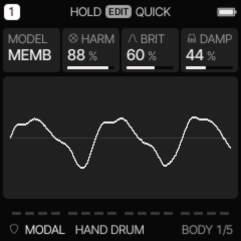
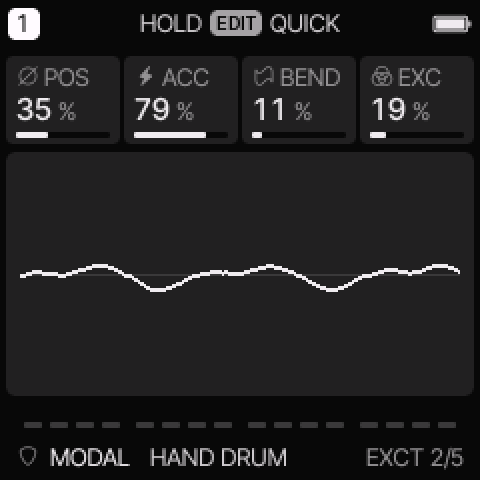

# MODAL engine

[All engines](ENGINE_GUIDE.md) · [Modes and shared controls](MODE_GUIDE.md)

Use MODAL for bars, bells, plates, struck metal, membranes, and hand-drum tones.

## How the sound is made

A strike excites several resonant modes. Their frequency relationships and decay form the sound. BAR changes between harmonic and inharmonic structures. MEMB uses a membrane model.

<figure>

<figcaption>MODAL on HOME. These knobs apply to the selected track unless HOME LEVELS is enabled.</figcaption>
</figure>
## HOME knobs

| Knob 1 | Knob 2 | Knob 3 | Knob 4 |
| --- | --- | --- | --- |
| STRC / HARM | BRIT | DAMP | POS |

For HOME LEVELS, see [HOME and mixer](MODE_GUIDE.md#home-and-mixer).

## Engine controls

Press the panel **EDIT** button to cycle the engine pages.
Pause between presses to avoid opening its shortcut layer.
The musical **EDIT key** is a different control.

### BODY page

<figure>

<figcaption>BODY is engine page 1.</figcaption>
</figure>
| Control | What it changes |
| --- | --- |
| MODEL | Select BAR or MEMB. |
| STRC / HARM | BAR: change the spacing of resonances. MEMB: move from an ideal membrane toward more harmonic loaded-membrane modes. |
| BRIT | Set strike brightness and how strongly high modes ring. |
| DAMP | Set model decay. Higher values ring longer. |

### EXCT page

<figure>

<figcaption>EXCT is engine page 2.</figcaption>
</figure>
| Control | What it changes |
| --- | --- |
| POS | Move the strike position and change which modes are excited. |
| ACC | Set the effect of velocity on strike strength, brightness, and decay. |
| BOW / BEND | BAR: add repeated excitation. MEMB: add a downward pitch bend after the strike. |
| EXC | Mix the direct strike signal into the output. |

## BAR and MEMB

BAR covers more than literal bars. STRC changes the resonance relationships for bells,
metal, plates, and more harmonic struck tones.
Around the lower-middle STRC range the partials are closer to harmonics.
Higher settings stretch them into less harmonic relationships.

MEMB changes STRC to **HARM** and BOW to **BEND** on the device.
HARM blends an ideal membrane toward a loaded membrane with more harmonic overtones.
POS moves the strike from the centre toward the rim.
BEND makes the pitch fall after the strike; it does not sustain the model like BAR's BOW.

Keep common SUS high to hear the resonator's decay.
The final amplitude envelope and the model decay both affect how long the sound is heard.

<figure>

<figcaption>MEMB changes STRC into HARM.</figcaption>
</figure>

<figure>

<figcaption>MEMB uses BEND in place of BAR’s sustained BOW excitation.</figcaption>
</figure>

## Try these changes

### Make a bell

Load **TOY BELL**. Change STRC in small steps. Adjust POS to alter the strike, then increase DAMP for a longer ring.

### Make a tuned membrane

Load **SYNTH TOM**. Compare low and high HARM. Increase BEND, then shorten DAMP if the tail masks later notes.

## Factory presets

**BELL TREE**, **MARIMBA**, **HAND DRUM**, **VIBE KEYS**, **TOY BELL**, **GAMELAN**, **STEEL TINE**, **SYNTH TOM**.

See the [inspired preset catalogue](INSPIRED_PRESETS.md) for the references behind the newer sounds.

## Limits and useful checks

MODAL has at most three voices per track within the total eight-voice budget. BAR and MEMB are pitched instruments. Use DRUM when you need independent kit lanes.

Save a user preset or project before loading another sound if you want to keep your edits.
