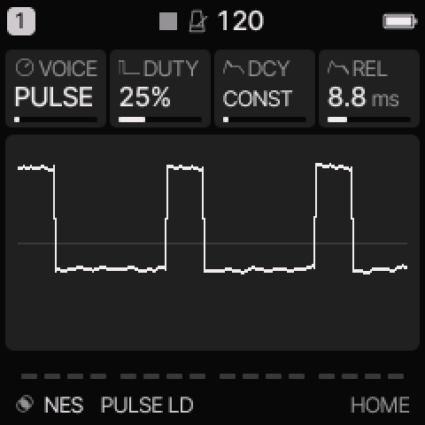
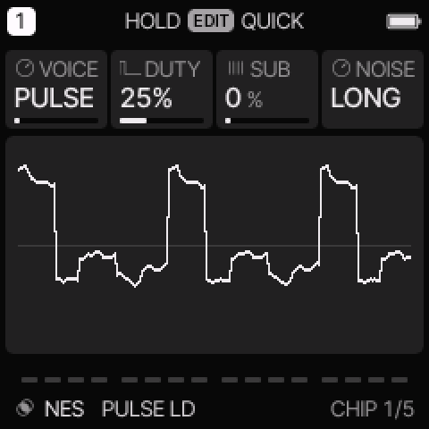
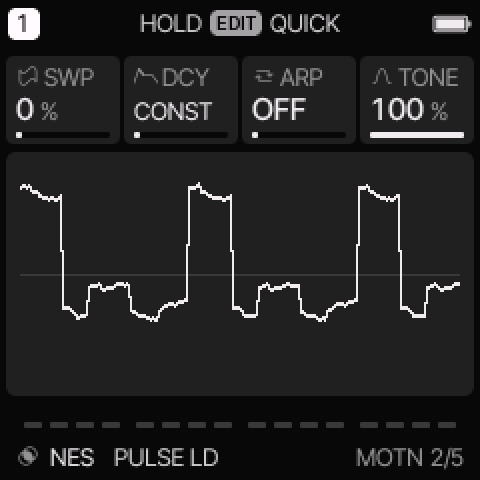

# NES engine

[All engines](ENGINE_GUIDE.md) · [Modes and shared controls](MODE_GUIDE.md)

Use NES for narrow pulse leads, stepped triangle basses, and console noise hits.

## How the sound is made

Each note uses a pulse, a stepped triangle, or clocked noise. A separate chip decay can reduce volume in sixteen steps. The common envelope still applies.

<figure>

<figcaption>NES on HOME. These knobs apply to the selected track unless HOME LEVELS is enabled.</figcaption>
</figure>
## HOME knobs

| Knob 1 | Knob 2 | Knob 3 | Knob 4 |
| --- | --- | --- | --- |
| VOICE | DUTY | DCY | REL |

For HOME LEVELS, see [HOME and mixer](MODE_GUIDE.md#home-and-mixer).

## Engine controls

Press the panel **EDIT** button to cycle the engine pages.
Pause between presses to avoid opening its shortcut layer.
The musical **EDIT key** is a different control.

### CHIP page

<figure>

<figcaption>CHIP is engine page 1.</figcaption>
</figure>
| Control | What it changes |
| --- | --- |
| VOICE | Select PULSE, TRI, or NOISE. |
| DUTY | For PULSE, select 12.5%, 25%, 50%, or 75% pulse width. |
| SUB | Mix in a triangle one octave below the main sound. |
| NOISE | Select LONG or SHORT noise feedback. This affects NOISE voice. |

### MOTN page

<figure>

<figcaption>MOTN is engine page 2.</figcaption>
</figure>
| Control | What it changes |
| --- | --- |
| SWP | Increase the downward pitch sweep. Very small settings have little or no effect. |
| DCY | Select CONST, a one-shot D decay, or an L looping decay. |
| ARP | Select OFF, OCT, MAJ, or MIN for the built-in fast pitch pattern. |
| TONE | Remove high frequencies at lower settings; use higher settings for a brighter output. |

## Voice and decay modes

PULSE is the lead voice. TRI uses a 32-position staircase for a rounded bass.
NOISE uses clocked feedback for snare, hat, and effect sounds.
DUTY does not change TRI or NOISE.

CONST keeps the chip volume steady. The common envelope still shapes the note.
D0 through D15 fade through sixteen volume levels. Higher D numbers take longer between steps.
L1 through L15 repeat the stepped fade while the note remains active.
The decay clock is faster than DMG's. Releasing the key still uses REL.

The engine ARP changes one voice's pitch rapidly. It is separate from the [shared arpeggiator](MODE_GUIDE.md#arpeggiator).

## Try these changes

### Compare pulse widths

Load **PULSE LD**. Hold one note and change DUTY. Try 12.5% for a narrow tone and 50% for a square tone.

### Make a short noise hit

Load **8BIT SNARE**. Compare LONG and SHORT noise. Adjust DCY and TONE, then change the common envelope if you need a shorter tail.

## Factory presets

**PULSE LD**, **WAVE BASS**, **NOISE HIT**, **FAMI HERO**, **FAMI LOW**, **FAMI ARP**, **8BIT SNARE**, **DUNGEON PAD**.

See the [inspired preset catalogue](INSPIRED_PRESETS.md) for the references behind the newer sounds.

## Limits and useful checks

NES is an inspired instrument. It does not reproduce console channel limits or play DPCM samples.

Save a user preset or project before loading another sound if you want to keep your edits.
