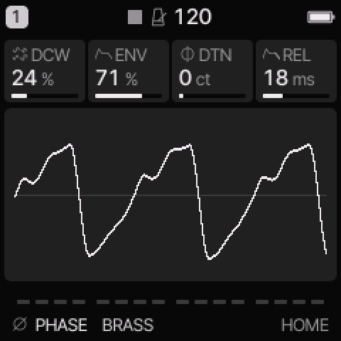
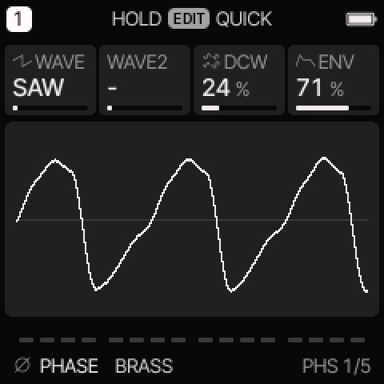
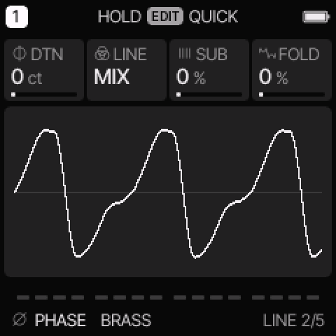

# PHASE engine

[All engines](ENGINE_GUIDE.md) · [Modes and shared controls](MODE_GUIDE.md)

Use PHASE for CZ-style basses, brass, resonant digital tones, and glass plucks.

## How the sound is made

Phase distortion changes how quickly an oscillator reads different parts of its wave. DCW sets this distortion. A second line can mix with the first or ring-modulate it.

<figure>

<figcaption>PHASE on HOME. These knobs apply to the selected track unless HOME LEVELS is enabled.</figcaption>
</figure>
## HOME knobs

| Knob 1 | Knob 2 | Knob 3 | Knob 4 |
| --- | --- | --- | --- |
| DCW | ENV | DTN | REL |

For HOME LEVELS, see [HOME and mixer](MODE_GUIDE.md#home-and-mixer).

## Engine controls

Press the panel **EDIT** button to cycle the engine pages.
Pause between presses to avoid opening its shortcut layer.
The musical **EDIT key** is a different control.

### PHS page

<figure>

<figcaption>PHS is engine page 1.</figcaption>
</figure>
| Control | What it changes |
| --- | --- |
| WAVE | Select the first phase-distortion shape. |
| WAVE2 | Select a second shape, or “-” to turn the second line off. |
| DCW | Set phase-distortion depth. It often acts as a brightness control. |
| ENV | Set how much the common envelope moves phase distortion. |

### LINE page

<figure>

<figcaption>LINE is engine page 2.</figcaption>
</figure>
| Control | What it changes |
| --- | --- |
| DTN | Detune the second line, in cents. |
| LINE | Select MIX or RING for the two lines. |
| SUB | Add the lower sine component. |
| FOLD | Add smooth wavefolding. Zero bypasses it. |

## Wave and line modes

| WAVE | Character |
| --- | --- |
| SAW, SQR, PLS | Saw-like, square-like, and pulse-like phase-distortion shapes. |
| DSIN | Double-sine shape. |
| SPLS | Shaped pulse. |
| RSAW, RTRI, RTRP | Resonant saw, triangle, and trapezoid families. |

MIX combines the lines. RING multiplies their signals for extra sum and difference tones.
Select a WAVE2 before comparing MIX and RING.
ENV here means distortion-envelope depth, not a second amplitude envelope.
The common ENV still sets the note's amplitude shape.

## Try these changes

### Make a digital brass swell

Load **BRASS**. Compare low and high DCW. Increase ENV and adjust common ATK so the brightness rises with the attack.

### Make a glass strike

Load **CZ GLASS**. Compare MIX and RING with the second line active. Add a small FOLD amount, then lower it if the attack becomes too bright.

## Factory presets

**BRASS**, **RESO**, **BELL**, **CZ BASS**, **CZ STRINGS**, **CZ GLASS**, **CZ ORGAN**, **CZ WIRE**.

See the [inspired preset catalogue](INSPIRED_PRESETS.md) for the references behind the newer sounds.

## Limits and useful checks

PHASE is phase-distortion synthesis, not the FM6 or YM algorithm system. Resonant shapes and ring modes can change loudness as well as tone.

Save a user preset or project before loading another sound if you want to keep your edits.
