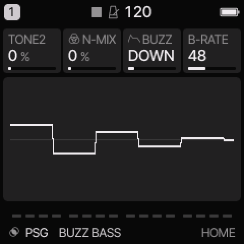
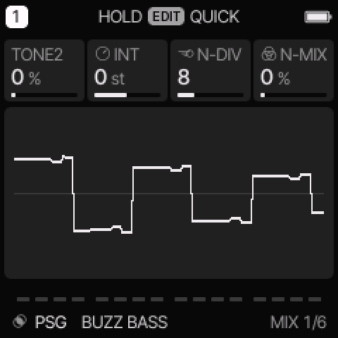
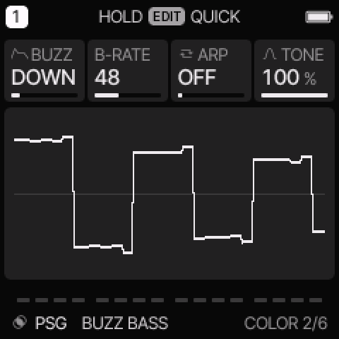
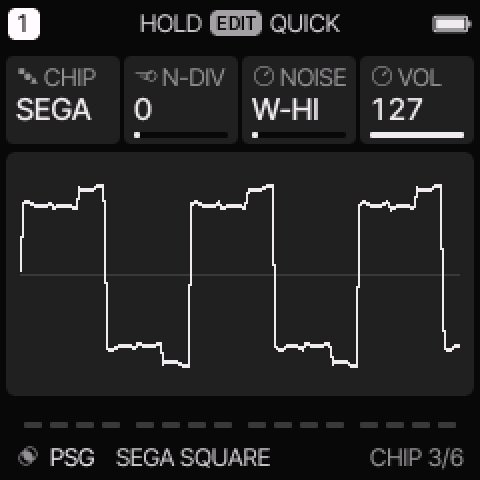

# PSG engine

[All engines](ENGINE_GUIDE.md) · [Modes and shared controls](MODE_GUIDE.md)

Use PSG for square leads, two-tone intervals, buzzer basses, and Sega noise percussion.

## How the sound is made

Two audible square tones mix with noise. CHIP selects an AY-inspired buzzer path or a Sega PSG core. The second tone can be tuned above or below the first.

<figure>

<figcaption>PSG on HOME. These knobs apply to the selected track unless HOME LEVELS is enabled.</figcaption>
</figure>
## HOME knobs

| Knob 1 | Knob 2 | Knob 3 | Knob 4 |
| --- | --- | --- | --- |
| TONE2 | N-MIX | BUZZ / NOISE | B-RATE / TONE |

For HOME LEVELS, see [HOME and mixer](MODE_GUIDE.md#home-and-mixer).

## Engine controls

Press the panel **EDIT** button to cycle the engine pages.
Pause between presses to avoid opening its shortcut layer.
The musical **EDIT key** is a different control.

### MIX page

<figure>

<figcaption>MIX is engine page 1.</figcaption>
</figure>
| Control | What it changes |
| --- | --- |
| TONE2 | Blend in the second square tone. |
| INT | Tune the second tone from −24 to +24 semitones. |
| N-DIV | Divide the noise clock. In Sega mode this affects linked noise only. |
| N-MIX | Move from square tones toward noise. |

### COLOR page

<figure>

<figcaption>COLOR is engine page 2.</figcaption>
</figure>
| Control | What it changes |
| --- | --- |
| BUZZ / NOISE | AY: choose a stepped buzzer shape. Sega: choose white or periodic noise and its clock. |
| B-RATE / VOL | AY: set the buzzer clock rate. Sega: set volume on the chip step ladder. |
| ARP | Select OFF, OCT, MAJ, or MIN for the built-in fast pitch pattern. |
| TONE | Set output brightness. |

## Select AY or Sega

1. Select a PSG preset.
2. Press EDIT until **CHIP** appears. Pause between presses.
3. Turn KNOB 1 to choose AY or SEGA.

<figure>

<figcaption>CHIP selects the synthesis path. It is also a separate card in the web editor.</figcaption>
</figure>

| Mode | HOME knobs 1–4 |
| --- | --- |
| AY | TONE2, N-MIX, BUZZ, B-RATE |
| SEGA | TONE2, N-MIX, NOISE, TONE |

AY BUZZ offers FLAT, DOWN, UP, TRI, RTRI, D-HLD, U-HLD, and PULSE.
FLAT bypasses the buzzer envelope, so B-RATE has no audible effect there.
DOWN, UP, TRI, RTRI, and PULSE repeat. D-HLD and U-HLD stop at their end level.
B-RATE can move from a slow volume pattern into an audible buzzer tone.

Sega NOISE offers W-HI, W-MID, W-LO, W-LNK, P-HI, P-MID, P-LO, and P-LNK.
W means white noise. P means periodic noise. LNK links the clock to the third tone divider.
That third tone is silent and supplies the noise clock.
N-DIV has no effect on the fixed HI, MID, and LO noise clocks.
VOL stays on the COLOR page and changes in sixteen effective steps, including mute.

## Try these changes

### Hear the AY buzzer

Load **AY BUZZ LEAD**. Compare FLAT and TRI. In TRI, turn B-RATE slowly. Leave N-MIX low to hear the tone clearly.

### Make a Sega hat

Load **SEGA HAT**. Confirm CHIP is SEGA. Compare W-HI and P-HI, then try W-LNK and adjust N-DIV. Keep a short common envelope.

## Factory presets

**BUZZ BASS**, **PSG CHORD**, **SEGA HIT**, **AY BUZZ LEAD**, **AY ZAP**, **SEGA SQUARE**, **SEGA CHORD**, **SEGA HAT**.

See the [inspired preset catalogue](INSPIRED_PRESETS.md) for the references behind the newer sounds.

## Limits and useful checks

The AY path is inspired synthesis. The Sega path uses a chip core with instrument mixing around it. Neither is a full console or game-music player.

Save a user preset or project before loading another sound if you want to keep your edits.
