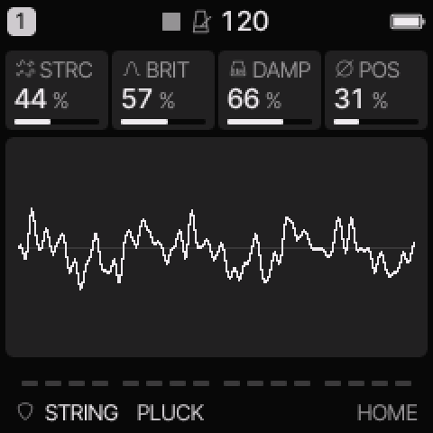
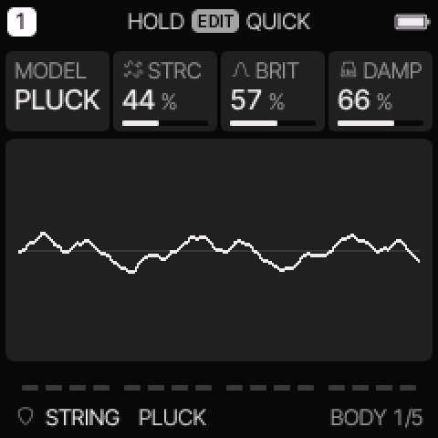
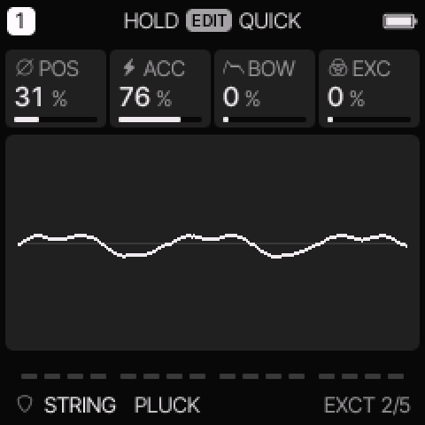
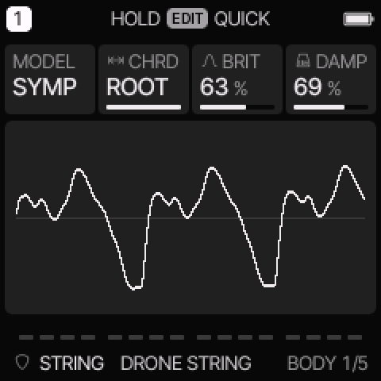
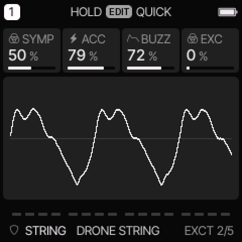

# STRING engine

[All engines](ENGINE_GUIDE.md) · [Modes and shared controls](MODE_GUIDE.md)

Use STRING for plucked strings, stiff or buzzing strings, sympathetic resonance, and sustained string textures.

## How the sound is made

A short excitation starts a simulated string. The string and its loop filters produce the decay. SYMP adds three sympathetic strings. The common amplitude envelope still controls the final note.

<figure>

<figcaption>STRING on HOME. These knobs apply to the selected track unless HOME LEVELS is enabled.</figcaption>
</figure>
## HOME knobs

| Knob 1 | Knob 2 | Knob 3 | Knob 4 |
| --- | --- | --- | --- |
| STRC / CHRD | BRIT | DAMP | POS / SYMP |

For HOME LEVELS, see [HOME and mixer](MODE_GUIDE.md#home-and-mixer).

## Engine controls

Press the panel **EDIT** button to cycle the engine pages.
Pause between presses to avoid opening its shortcut layer.
The musical **EDIT key** is a different control.

### BODY page

<figure>

<figcaption>BODY is engine page 1.</figcaption>
</figure>
| Control | What it changes |
| --- | --- |
| MODEL | Select PLUCK or SYMP. |
| STRC / CHRD | PLUCK: change bridge behavior and string stiffness. SYMP: choose the sympathetic tuning group. |
| BRIT | Set excitation brightness and the string loop tone. |
| DAMP | Set the model decay. Higher values ring longer, despite the DAMP label. |

### EXCT page

<figure>

<figcaption>EXCT is engine page 2.</figcaption>
</figure>
| Control | What it changes |
| --- | --- |
| POS / SYMP | PLUCK: set pluck position. SYMP: set coupling into the sympathetic strings. |
| ACC | Set how much velocity strengthens and brightens the excitation. |
| BOW / BUZZ | PLUCK: add repeated excitation for a sustained texture. SYMP: increase bridge buzz. |
| EXC | Mix the direct pick or excitation signal into the output. |

## PLUCK and SYMP

In PLUCK, low STRC values give a curved, buzzing bridge response.
Higher values add stiff-string dispersion. POS changes the pluck's harmonic balance.
BOW sustains the model with repeated random excitation. It is not a recorded bowed instrument.

In SYMP, several labels change on the device:

| PLUCK label | SYMP label | New function |
| --- | --- | --- |
| STRC | CHRD | Tune the sympathetic strings: OCT, 5TH, 4TH, MAJ, MIN, SUS, 7TH, or ROOT. |
| POS | SYMP | Change sympathetic coupling. |
| BOW | BUZZ | Change the bridge buzz. |

ROOT uses the track's scale root with its fifth and octave.
These sympathetic pitches belong to one modelled voice; they are separate from chord-key note entry.

Keep common SUS high if you want to hear the string's natural decay.
Use REL or a row gate to stop a long ring.

<figure>

<figcaption>SYMP changes STRC into CHRD.</figcaption>
</figure>

<figure>

<figcaption>SYMP also changes POS into SYMP and BOW into BUZZ.</figcaption>
</figure>

## Try these changes

### Make a dry pluck

Load **CLAVI PLUCK**. Keep BOW at zero. Change POS, then reduce DAMP for a shorter model decay. Compare soft and hard notes.

### Hear sympathetic resonance

Load **HARP**. Compare CHRD choices while holding one note. Raise SYMP gradually. Use ROOT if you want resonance related to the track root.

## Factory presets

**PLUCK**, **DRONE STRING**, **HARP**, **KOTO PICK**, **SITAR BUZZ**, **ZITHER**, **CLAVI PLUCK**, **BOWED WIRE**.

See the [inspired preset catalogue](INSPIRED_PRESETS.md) for the references behind the newer sounds.

## Limits and useful checks

STRING has at most three voices per track and shares the total eight-voice budget. Long decays can use those voices quickly. The models synthesize the strings; they do not play instrument samples.

Save a user preset or project before loading another sound if you want to keep your edits.
