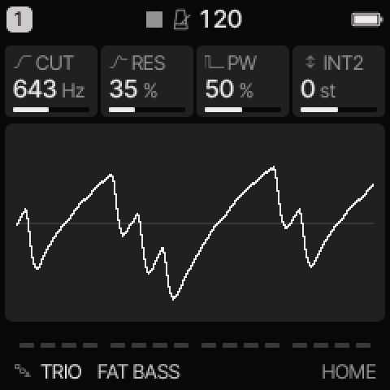
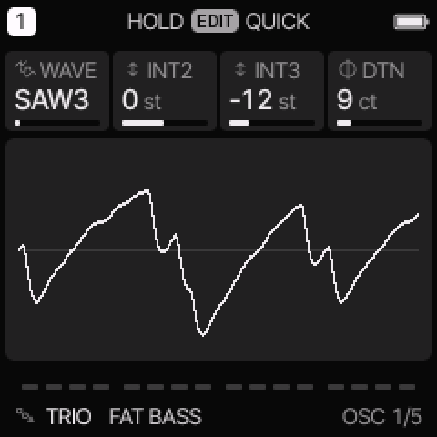
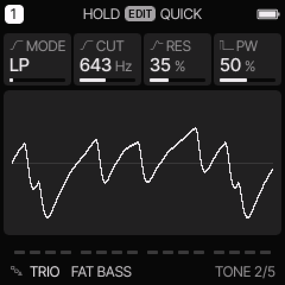

# TRIO engine

[All engines](ENGINE_GUIDE.md) · [Modes and shared controls](MODE_GUIDE.md)

Use TRIO for three-oscillator basses, pulse-width leads, sync sweeps, and ring-modulated metal.

## How the sound is made

Three oscillators feed a multimode filter. WAVE selects a complete oscillator combination. Some combinations use hard sync, ring modulation, or bitwise combined waves.

<figure>

<figcaption>TRIO on HOME. These knobs apply to the selected track unless HOME LEVELS is enabled.</figcaption>
</figure>
## HOME knobs

| Knob 1 | Knob 2 | Knob 3 | Knob 4 |
| --- | --- | --- | --- |
| CUT | RES | PW | INT2 |

For HOME LEVELS, see [HOME and mixer](MODE_GUIDE.md#home-and-mixer).

## Engine controls

Press the panel **EDIT** button to cycle the engine pages.
Pause between presses to avoid opening its shortcut layer.
The musical **EDIT key** is a different control.

### OSC page

<figure>

<figcaption>OSC is engine page 1.</figcaption>
</figure>
| Control | What it changes |
| --- | --- |
| WAVE | Select an oscillator combination. See the groups below. |
| INT2 | Tune oscillator 2 relative to the played note, in semitones. |
| INT3 | Tune oscillator 3 relative to the played note, in semitones. |
| DTN | Detune oscillator 2 up and oscillator 3 down, in cents. |

### TONE page

<figure>

<figcaption>TONE is engine page 2.</figcaption>
</figure>
| Control | What it changes |
| --- | --- |
| MODE | Select LP, BP, HP, or NOT (notch) filtering. |
| CUT | Set the filter cutoff. |
| RES | Increase emphasis near the filter cutoff. |
| PW | Set pulse width. ENV or LFO routed to SHP moves it. |

## Oscillator combinations

| Group | WAVE choices | Result |
| --- | --- | --- |
| Basic stacks | SAW3, PLS3, PPT, SST, TRI3 | Three saws, pulses, triangles, or mixed stacks. |
| Combined waves | S&T, P&S | Bitwise combinations with a more complex harmonic shape. |
| Noise | P+N, NOIS | Pulse/noise combination or pitched noise. |
| Hard sync | SYNC, SYNCP, SYNC3 | One oscillator restarts another on each cycle. |
| Ring modulation | RING, RING3, R+S, R+SP | Oscillator interaction for metal and bell-like tones. |

INT2 and INT3 can change the tone as well as the apparent harmony in sync and ring modes.
A silent oscillator can still act as a ring modulator.

## Try these changes

### Animate a pulse lead

Load **SID PWM**. On LFO DEST, add a small SHP amount. Compare a slow and fast LFO RATE. Adjust PW to move the centre of the sweep.

### Tune a metal sound

Load **SID METAL**. Hold a note while changing INT3 by one semitone at a time. Compare simple intervals with less regular ones.

## Factory presets

**FAT BASS**, **SYNC LEAD**, **RING BELL**, **SID PWM**, **SID RUBBER**, **SID SYNC**, **SID METAL**, **SID CHOIR**.

See the [inspired preset catalogue](INSPIRED_PRESETS.md) for the references behind the newer sounds.

## Limits and useful checks

TRIO is SID-inspired. It does not reproduce a specific SID revision. Some combined waves can sound rougher at high notes.

Save a user preset or project before loading another sound if you want to keep your edits.
