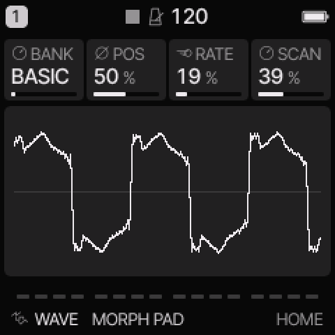
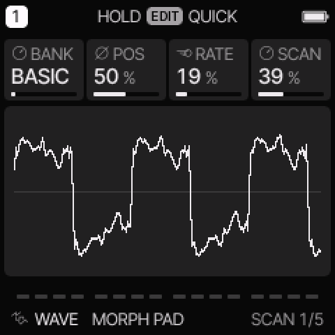
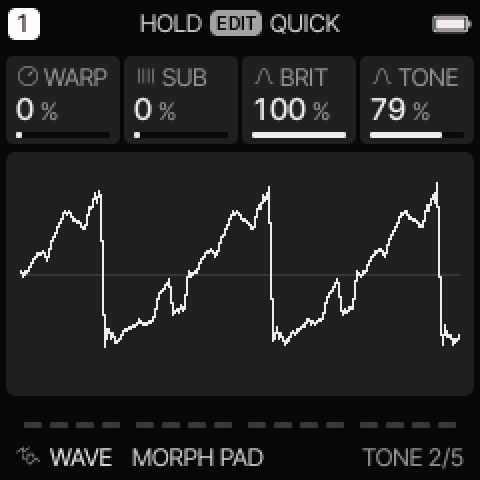

# WAVE engine

[All engines](ENGINE_GUIDE.md) · [Modes and shared controls](MODE_GUIDE.md)

Use WAVE for changing digital pads, hollow leads, glass tones, and wave-table basses.

## How the sound is made

Each bank has four waves. POS blends between adjacent waves on a line. RATE and SCAN add automatic movement around POS. WARP bends the reading phase for extra harmonics.

<figure>

<figcaption>WAVE on HOME. These knobs apply to the selected track unless HOME LEVELS is enabled.</figcaption>
</figure>
## HOME knobs

| Knob 1 | Knob 2 | Knob 3 | Knob 4 |
| --- | --- | --- | --- |
| BANK | POS | RATE | SCAN |

For HOME LEVELS, see [HOME and mixer](MODE_GUIDE.md#home-and-mixer).

## Engine controls

Press the panel **EDIT** button to cycle the engine pages.
Pause between presses to avoid opening its shortcut layer.
The musical **EDIT key** is a different control.

### SCAN page

<figure>

<figcaption>SCAN is engine page 1.</figcaption>
</figure>
| Control | What it changes |
| --- | --- |
| BANK | Choose BASIC, COLOR, PPG, ESQ, or VS. |
| POS | Set the position between the bank’s four waves. |
| RATE | Set automatic scan speed. Zero stops the scan clock. |
| SCAN | Set automatic scan depth. Zero removes scan movement. |

### TONE page

<figure>

<figcaption>TONE is engine page 2.</figcaption>
</figure>
| Control | What it changes |
| --- | --- |
| WARP | Bend the reading phase to change the harmonic shape. |
| SUB | Mix in a sine one octave below. |
| BRIT | Control the available harmonic brightness. |
| TONE | Set output smoothing and brightness. |

## Banks and scanning

| Bank | Four wave characters |
| --- | --- |
| BASIC | Sine, triangle, square, saw. |
| COLOR | Hollow, glass, octaves, bright glass. |
| PPG | Nasal, comb, vocal, metal. |
| ESQ | Bass, reed, keys, hollow reed. |
| VS | Airy, glass, brass, shimmer. |

These are original wave recipes inspired by older digital synth families.
The names do not indicate imported ROM waves.
VS uses linear scanning through four waves. It does not add a two-axis vector mixer.

Set SCAN to zero when you want to hear POS by itself.
For automatic motion, both RATE and SCAN must be above zero.
Movement stops at the bank edges rather than wrapping to another bank.
The scan starts from its initial phase on each new note.

## Try these changes

### Make a slow pad

Load **VS AIR**. Keep POS near the middle. Set a low RATE and a moderate SCAN amount. Use a slow common attack and a longer release.

### Compare bright and dark waves

Load **PPG METAL**. Set SCAN to zero. Move POS slowly, then compare BRIT and TONE. Add a small WARP amount after you find a useful position.

## Factory presets

**MORPH PAD**, **GLASS WALK**, **WAVE SUB**, **PPG CHOIR**, **ESQ BRASS**, **VS AIR**, **PPG METAL**, **ESQ REED**.

See the [inspired preset catalogue](INSPIRED_PRESETS.md) for the references behind the newer sounds.

## Limits and useful checks

The bank is built in; custom wave import is not available. High-note WARP is deliberately reduced to control unwanted high-frequency products. The engine does not oversample.

Save a user preset or project before loading another sound if you want to keep your edits.
