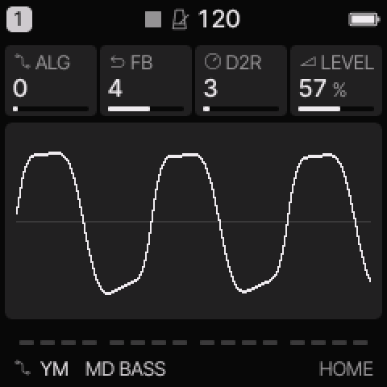
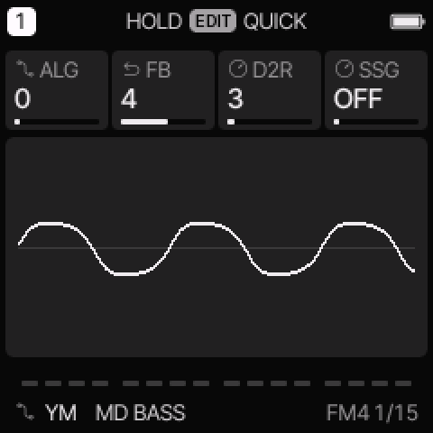
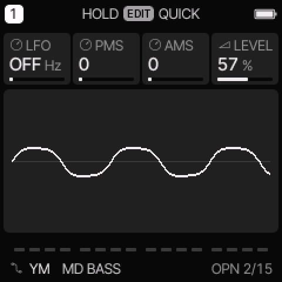

# YM engine

[All engines](ENGINE_GUIDE.md) · [Modes and shared controls](MODE_GUIDE.md)

Use YM for Genesis-style FM bass, brass, reeds, bells, and sharp arcade leads.

## How the sound is made

Four operators use YM2612-style algorithms, envelopes, feedback, and pitch or amplitude modulation. The operator envelopes use chip rates and attenuation levels. This engine is separate from FM6.

<figure>

<figcaption>YM on HOME. These knobs apply to the selected track unless HOME LEVELS is enabled.</figcaption>
</figure>
## HOME knobs

| Knob 1 | Knob 2 | Knob 3 | Knob 4 |
| --- | --- | --- | --- |
| ALG | FB | D2R | LEVEL |

For HOME LEVELS, see [HOME and mixer](MODE_GUIDE.md#home-and-mixer).

## Engine controls

Press the panel **EDIT** button to cycle the engine pages.
Pause between presses to avoid opening its shortcut layer.
The musical **EDIT key** is a different control.

### FM4 page

<figure>

<figcaption>FM4 is engine page 1.</figcaption>
</figure>
| Control | What it changes |
| --- | --- |
| ALG | Select one of eight operator algorithms, numbered 0–7. |
| FB | Set chip feedback from 0–7. |
| D2R | Set the shared second decay rate, 0–31. Higher rates decay faster; zero holds this stage. |
| SSG | Select OFF or one of eight special envelope shapes. |

### OPN page

<figure>

<figcaption>OPN is engine page 2.</figcaption>
</figure>
| Control | What it changes |
| --- | --- |
| LFO | Select OFF or a chip LFO rate. |
| PMS | Set pitch-modulation sensitivity, 0–7. |
| AMS | Set amplitude-modulation sensitivity, 0–3. |
| LEVEL | Set the engine output gain. |

## Operator envelopes and tone

The common track ADSR does not set YM's amplitude envelope.
Use the four OP ENV pages and OP LEVEL.

| Control | Meaning |
| --- | --- |
| AR | Attack rate, 0–31. Higher is faster. Zero does not produce a normal rising attack. |
| D1R | First decay rate, 0–31. Higher is faster. |
| D1L | First decay attenuation, 0–15. Higher is quieter. |
| RR | Release rate, 0–15. Higher is faster. |
| TL | Total attenuation, 0–127. Higher is quieter; zero is the loudest setting. |
| MUL | Operator frequency multiplier, 0–15. Zero means one-half, not silence. |
| DT | Fine detune, −3 through +3. |
| KS | Shared key scaling, 0–3. Higher settings make envelopes speed up more on higher notes. |
| AMOPS | Operator mask, 0–15. Enables amplitude modulation on selected operators. |

OP1 TONE through OP4 TONE select each operator's MUL, DT, and TL.
KS is shared even when shown on an operator page.
D2R and SSG are also shared across the operators.

AMOPS uses bits 1, 2, 4, and 8 for operators 1, 2, 3, and 4.
For example, 5 enables operators 1 and 3; 15 enables all four.
AM needs LFO, AMS, and an enabled operator. PMS controls pitch modulation separately.
An SSG shape can repeat or hold an envelope stage. Try it first on a held note.

## Try these changes

### Change bass bite

Load **MD BASS**. Compare FB values while repeating a short note. Then change D2R to adjust the held part of the envelope.

### Add vibrato

Load **MD REED**. Select a slow LFO rate and increase PMS from zero. For tremolo, use AMS and enable the required operators with AMOPS.

## Factory presets

**MD BASS**, **FM BRASS**, **METAL BELL**, **MD SLAP**, **MD REED**, **ARCADE LEAD**, **MD EPIANO**, **MD CHIME**.

See the [inspired preset catalogue](INSPIRED_PRESETS.md) for the references behind the newer sounds.

## Limits and useful checks

YM has at most six voices per track within the shared eight-voice budget. The instrument includes the chip ladder DAC behavior. It does not expose PCM streaming, channel-3 special mode, or CSM timer playback.

Save a user preset or project before loading another sound if you want to keep your edits.
