# Yanfei modes and shared controls

This guide explains what each main page does and which controls apply there.
It covers Yanfei v1.6.1-y13 on the FM-1.
Use the [engine guide](ENGINE_GUIDE.md) for each engine's sound controls.
Use the [user guide](USER_GUIDE.md) for complete song and storage procedures.

## Contents

- [Buttons, pages, and layers](#buttons-pages-and-layers)
- [HOME and mixer](#home-and-mixer)
- [Tracker views](#tracker-views)
- [NAV, NOTE, and ARM](#nav-note-and-arm)
- [STEP, DETAIL, and AUTOMATION](#step-detail-and-automation)
- [Envelope](#envelope)
- [LFO and modulation matrix](#lfo-and-modulation-matrix)
- [Engine edit and voice modes](#engine-edit-and-voice-modes)
- [Effects](#effects)
- [Scale and chord](#scale-and-chord)
- [Arpeggiator](#arpeggiator)
- [Performance layers](#performance-layers)
- [Save pages](#save-pages)
- [Settings menu and MIDI](#settings-menu-and-midi)
- [When a control seems to do nothing](#when-a-control-seems-to-do-nothing)

## Buttons, pages, and layers

The panel EDIT button and musical EDIT key are different controls.
A panel button normally opens a page family. Further presses cycle that family's pages.
Pause between presses to avoid the double-press shortcut.
The display's page name and page number show your position.

A **layer** temporarily gives the keys and knobs another purpose.
Hold FX, GLO, SCL, EDIT, SEQ, or REC to see its shortcut map.
Release the button to close the layer.
A quick double press can keep its layer open; press its button again to close it.
Tracker REC taps are an exception: they change note-entry state.

| Panel button | Normal pages or function |
| --- | --- |
| HOME | HOME, MIXER, CLOCK; in the tracker, toggle following. Hold for the menu. |
| ENV | ENV, ENV DEST. |
| LFO | LFO, LFO 2, LFO DEST, MOD. |
| EDIT | Engine pages, extra engine controls, VOICE, VOICE 2, VOICE 3. |
| FX | FX, SLICER, INSERT, INSERT 2, DLY, REVERB, CHORUS. |
| SCL | SCL, CHORD. |
| ARP | ARP, ARP 2. |
| SEQ | Tracker, STEP, DETAIL, AUTOMATION. |
| GLO | Tracker SONG when the tracker library is active. |
| SAVE | User sounds, factory browser, phrase browser, projects, tools. |
| PLAY | Start or stop the transport for the current context. |
| REC | Note entry or recording, according to the current page. |

## HOME and mixer

HOME gives four quick controls for the selected engine.
The [engine pages](ENGINE_GUIDE.md) list their assignments.
ALGORITHM selects a track. PRESETS selects a sound.

Outside the tracker, repeated HOME presses cycle **HOME → MIXER → CLOCK → HOME**.
From another sound page, HOME returns to HOME first.
Inside the tracker, HOME toggles playhead following instead.
Press ENV, then HOME, when you want the sound page.

<figure>
<a href="images/engines/mode-mixer.png">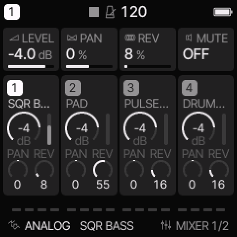</a>
<figcaption>MIXER changes the selected track. Use ALGORITHM to select another track.</figcaption>
</figure>

| MIXER knob | Function |
| --- | --- |
| 1: LEVEL | Selected track level. |
| 2: PAN | Selected track stereo position. |
| 3: REV | Selected track reverb send. |
| 4: MUTE | Selected track mute. |

On CLOCK, BPM sets tempo, SWG sets global swing, and CLK selects INT, USB, or TRS clock.
For external clock, connect a running clock source.
A missing external clock can prevent normal sequencer movement.

MENU > DISPLAY > HOME selects SCOPE, TRACKS, or LEVELS.
SCOPE shows the output trace. TRACKS shows a track overview with sound controls.
LEVELS gives the overview with track level knobs.

The HOME LEVELS option replaces the four engine knobs on HOME with track 1–4 levels.
This is a setting, not a different sound engine.
If HOME shows levels instead of the engine controls, check this option.

## Tracker views

The tracker has four views. ALL is the default after a restart.
It retains a selected view when you leave and return during that session.

| View | Shows | Use it to |
| --- | --- | --- |
| ALL | Four track columns, one cell per track and row. | Build the section and edit complete note sets. |
| PHRASE | Four note columns or eight drum lanes, plus row settings. | Edit one pitch, a drum lane, or an instrument reference. |
| CHAIN | Phrase references and transpose values. | Put reusable phrases in order for one track. |
| SONG | A chain reference per track and section. | Arrange the complete song. |

<figure>

<figcaption>ALL shows one or two pitches directly. Larger sets show a chord name or MULTI.</figcaption>
</figure>

<figure>

<figcaption>PHRASE exposes separate pitches and the instrument reference.</figcaption>
</figure>

<figure>

<figcaption>CHAIN sequences phrases for one track.</figcaption>
</figure>

<figure>

<figcaption>SONG arranges sections across all four tracks.</figcaption>
</figure>

### Move between views

- In ALL or PHRASE, hold SHIFT and press UP to switch between them.
- From PHRASE, press SHIFT + LEFT for CHAIN. Use it again for SONG.
- From SONG, select a filled chain reference and press SHIFT + RIGHT to open it.
- From CHAIN, select a filled phrase reference and press SHIFT + RIGHT to open it.
- In SONG, SHIFT + UP opens the selected section in ALL.

Opening or editing an empty reference can create a new library item.
Selecting an existing reference shares that item.
Clone it before editing if other parts must keep the original notes.

### Edit a section or a separate phrase

Section editing follows one song row across up to four pages.
At 1/16 division with full sixteen-row phrases, a page is one bar.
Four pages are 64 rows, or sixteen musical beats.
SELECT and UP/DOWN scroll across pages. SHIFT + SELECT changes page directly.
SHIFT + OPTION + SELECT sets AUTO or one through four bars.

Separate phrase editing shows one library phrase of at most sixteen rows.
SHIFT + DOWN switches section/separate phrase editing in ALL or PHRASE.
The page heading changes so you can identify which context is active.
Changing a shared phrase changes each reference to that phrase.

### Playback depends on the view

| Context | PLAY starts |
| --- | --- |
| Section editing | A loop of the selected section across all four tracks. |
| Separate PHRASE | A loop of the selected track's phrase. |
| CHAIN | The selected track's chain from the selected link. |
| SONG | The arrangement from the selected section. |
| SHIFT + PLAY in the tracker | The arrangement from the selected song row. |

PLAY again stops playback.
For a timed section, OPTION + PRESETS selects repeat or wait for the selected track.
A shorter chain can repeat until the section ends, or play once and wait.
Longer material stops at the section boundary.

## NAV, NOTE, and ARM

These are tracker keyboard states, independent of ALL/PHRASE/CHAIN/SONG.
Use note entry in ALL or PHRASE while playback is stopped.

| State | Musical key behavior | How to select it |
| --- | --- | --- |
| NAV | Tracker controls navigate; note-entry keys do not play or write notes. | Default; leave NOTE with REC. |
| NOTE | The sixteen middle keys enter notes at the selected row. | Press REC once from NAV. |
| ARM | The selected track is armed for live recording. | In separate phrase editing, press REC again from NOTE. |

In section editing, REC cycles **NAV ↔ NOTE**.
In separate phrase editing, REC cycles **NAV → NOTE → ARM → NAV**.
ARM does not start playback by itself.
Arrangement recording remains disabled; stop chain or song playback before note editing.

### Enter a note and advance

1. Stop playback and select a row in ALL or PHRASE.
2. Press REC until NOTE appears.
3. Play one of the physical keys from A#3 through C#5.
4. Release it. The cursor advances one row.

Hold several keys to enter a chord of up to four notes.
The cursor waits until the last note-entry key is released.
A new entry replaces the row's note set; it does not add a note to the old set.
Use detailed PHRASE to change one pitch inside an existing chord.

F#3 writes OFF and advances. EDIT + F#3 writes a tie and advances.
An empty row can let an earlier note continue. OFF releases it.
For a shorter note inside one row, set a finite row gate with OPTION + SELECT.
See [note duration](USER_GUIDE.md#set-note-duration).

## STEP, DETAIL, and AUTOMATION

These pages sit beside the tracker in the SEQ family.
They are not extra tracker arrangement views.
Press SEQ to cycle them.

| Page | Main use | Knobs or actions |
| --- | --- | --- |
| STEP | View and edit the selected track's steps in the older step/roll interface. | Melodic: STEP, NOTE, LEN/TIME, FLAG. Drum: STEP, LANE, HIT, ACC. |
| DETAIL | Edit the selected row's trigger settings. | CHANCE, RATCH, NUDGE, VEL. |
| AUTOMATION | Inspect and edit recorded parameter events and locks. | Use the displayed event list and footer actions. |

<figure>
<a href="images/engines/mode-detail.png">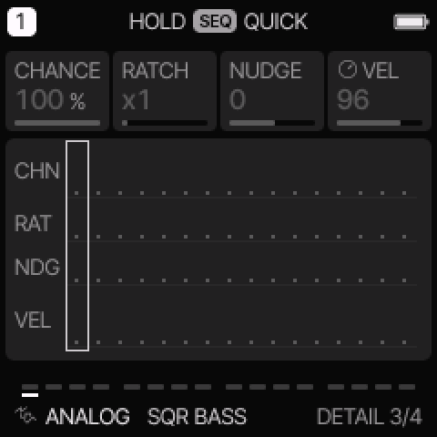</a>
<figcaption>DETAIL changes these row values. In the main tracker, the sound knobs keep their engine assignments.</figcaption>
</figure>

<figure>
<a href="images/engines/mode-step.png">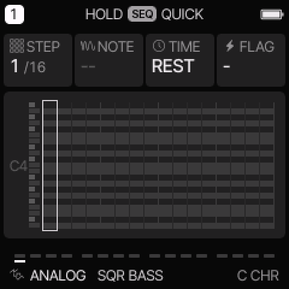</a>
<figcaption>STEP provides the older roll and step controls.</figcaption>
</figure>

<figure>
<a href="images/engines/mode-automation.png">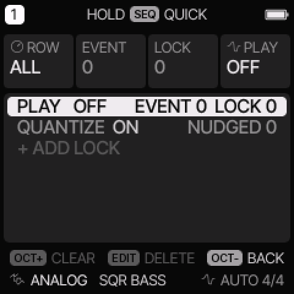</a>
<figcaption>AUTOMATION lists parameter events and non-default step fields.</figcaption>
</figure>

CHANCE selects a probability, a cycle condition such as 1:2, FILL, or !FILL.
These are alternatives in one field. RATCH triggers one through four times within a step.
NUDGE moves the trigger earlier or later when step quantization permits it.
VEL changes attack strength; its effect also depends on the engine.
Dim fields do not currently apply.

In the tracker footer, CH, RT, ND, and VEL show the selected row's values.
They do not change the four sound knobs into DETAIL knobs.
For locks and recording, follow [parameter locks](USER_GUIDE.md#use-parameter-locks) and
[live recording](USER_GUIDE.md#record-while-the-phrase-plays).

## Envelope

Press ENV for the common four-stage amplitude envelope.

<figure>
<a href="images/engines/mode-env.png">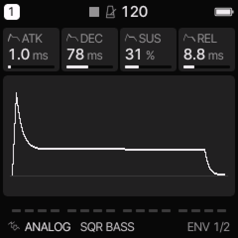</a>
<figcaption>ENV sets the note shape on engines that use the common amplitude envelope.</figcaption>
</figure>

| Control | Meaning |
| --- | --- |
| ATK | Time taken to rise after a note starts. |
| DEC | Time taken to fall from the attack peak toward sustain. |
| SUS | Held amplitude level, not a duration. |
| REL | Time taken to fall after note-off. |

ENV DEST has FLT, PIT, SHP, and ESYNC.
FLT, PIT, and SHP send envelope movement to tone/filter, pitch, and shape destinations.
Negative depths reverse the movement. The destination's audible meaning depends on the engine.
ESYNC changes attack, decay, and release to tempo-related durations.
It does not turn SUS into a duration.

For a simple pluck, use a fast attack, lower sustain, and a short decay.
For a pad, use a slower attack, higher sustain, and a longer release.
FM6 and YM use operator envelopes. DRUM uses its hit envelopes.
Those engines need their own decay and release controls.

## LFO and modulation matrix

An LFO is a repeating control signal. It can move pitch, tone, shape, or amplitude.
Press LFO to cycle LFO, LFO 2, LFO DEST, and MOD.
**LFO 2 is a second settings page for the same LFO, not a second oscillator.**

<figure>
<a href="images/engines/mode-lfo.png">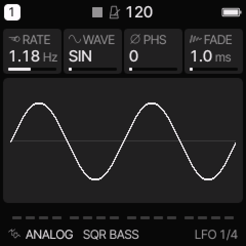</a>
<figcaption>The LFO needs a nonzero destination depth before it changes the sound.</figcaption>
</figure>

| Page | Controls |
| --- | --- |
| LFO | RATE: speed; WAVE: SIN, TRI, SAW, SQR, or S&H; PHS: starting phase; FADE: fade-in time. |
| LFO 2 | SYNC: clock division or OFF; TRIG: NOTE or FREE; POL: BI or UNI. |
| LFO DEST | PIT, FLT, SHP, AMP depths. |
| MOD | Four source → destination routes, each with its own amount. |

SIN is smooth. TRI rises and falls linearly. SAW ramps and resets.
SQR switches between levels. S&H holds a random value for each cycle.
SYNC overrides free RATE when it is enabled.
NOTE restarts the LFO at its starting phase on a fresh note phrase; FREE keeps it running.
BI moves below and above zero. UNI moves from zero in one direction.

For vibrato, start with SIN, a slow RATE, and a small PIT depth.
For a pulse-width sweep on ANALOG or TRIO, use a small SHP depth.
To hear a fade-in, hold the note long enough for FADE to increase the depth.

<figure>
<a href="images/engines/mode-mod.png">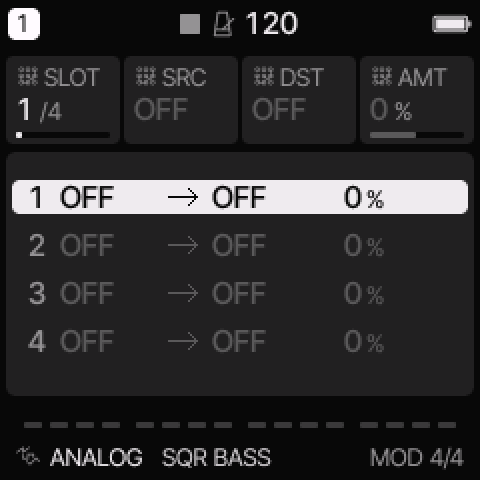</a>
<figcaption>MOD provides four routes; select one with KNOB 1.</figcaption>
</figure>

On MOD, KNOB 1 selects a slot. The other knobs set source, destination, and amount.
A source or destination set to OFF makes the route inactive.
Sources include LFO, ENV, velocity, key pitch, random, mod wheel, aftertouch, expression,
sample-and-hold, and its smoothed SLEW form.
Destinations include pitch, tone, shape, level, pan, effects, LFO rate, and the engine's eight controls.
Some destinations affect note starts rather than a continuously held voice.

## Engine edit and voice modes

Press EDIT to cycle the pages available for the selected engine.
The [engine guide](ENGINE_GUIDE.md) explains its main and special pages.
VOICE pages follow the engine controls.

| VCE | Behavior |
| --- | --- |
| POLY | Several notes can sound together, within the available voice budget. |
| MONO | One selected note sounds; new notes retrigger it. |
| LEG | One selected note sounds; overlapping notes can change pitch without restarting its envelope. |
| UNI | Several detuned voices sound one note, as available. |

GLD sets glide. GLMOD selects RATE or TIME behavior.
PRIO selects LAST, LOW, or HIGH for competing held notes in single-note modes.
ALLOC selects rotating or reused voice allocation.
DTUNE sets unison detune. SPRD spreads eligible voices around the track PAN position.
MUTE silences the track; LEVEL and PAN set its mix position.
DRUM retains its lane behavior rather than these melodic voice modes.

A synth track in MONO, LEG, or UNI does not produce a normal polyphonic chord
merely because a tracker row stores several pitches.
Start with POLY when checking entered chords.
All tracks share eight active voices. Engine caps can be lower.

## Effects

Press FX to cycle the effect pages.
Track sends and shared effect settings have different scopes.

<figure>
<a href="images/engines/mode-fx.png">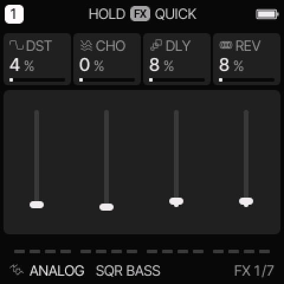</a>
<figcaption>FX sets the selected track's amounts. Shared bus pages affect tracks using those buses.</figcaption>
</figure>

| Page | Scope | Controls |
| --- | --- | --- |
| FX | Selected track | DST distortion; CHO, DLY, REV effect sends. |
| SLICER | Selected track | OFF, GATE, or STUT; pattern, rate, depth. |
| INSERT | Selected track | Effect type and three controls whose labels follow the type. |
| INSERT 2 | Selected track | MIX between the dry and processed signal. |
| DLY | Shared | TIME, FDBK, COLR, MIX. |
| REVERB | Shared | TYPE, SIZE, DAMP. |
| CHORUS | Shared | Rate and depth. |

<figure>
<a href="images/engines/mode-insert.png">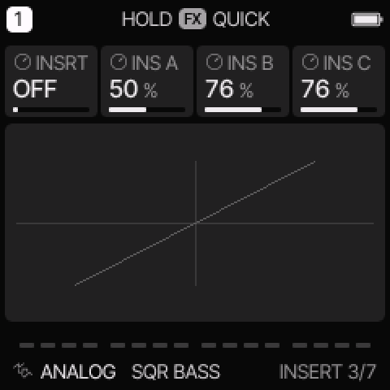</a>
<figcaption>INSERT affects one track before its shared effect returns.</figcaption>
</figure>

SLICER GATE uses rhythmic level changes. STUT repeats short captured sections of the signal.
DEPTH sets how strongly it acts. This is an effect, not a sample-loop slicing engine.

| INSERT type | Three controls | Use |
| --- | --- | --- |
| OFF | Inactive | Bypass the insert. |
| SOFT, HARD, FOLD, FUZZ | DRIVE, TONE, LEVEL | Different drive and distortion shapes. |
| CRUSH | BITS, RATE, LPF | Reduce resolution and sample rate; smooth the result. |
| PHASR, FLANG, CHOR | RATE, DEPTH, FDBK | Moving phase, flanger, or chorus effects. |

The insert CHOR is per track. The CHORUS page changes the shared chorus bus.
Delay feedback makes repeats last longer. Delay TIME uses note divisions, including dotted choices.
Reverb TYPE selects ROOM, SPRING, or HALL.
Reverb DAMP is a reverb tone control; it is separate from STRING/MODAL model DAMP.
If the shared reverb changes, every track with a reverb send can sound different.

## Scale and chord

Press SCL for ROOT, SCL, QNT, and TRN. Press again for CHRD and VOIC.
ROOT is the musical root. SCL selects the scale. TRN transposes in semitones.

| QNT mode | Use |
| --- | --- |
| OFF | Normal chromatic key mapping. |
| SNAP | Snap played keyboard pitches to the selected scale. |
| WHITE | Put the scale on white keys; black keys are silent. |
| SEQ | Snap keyboard and sequencer playback to the scale. |
| SEQ+T | Also apply the track transpose behavior to sequencer playback. |

<figure>
<a href="images/engines/mode-scale.png">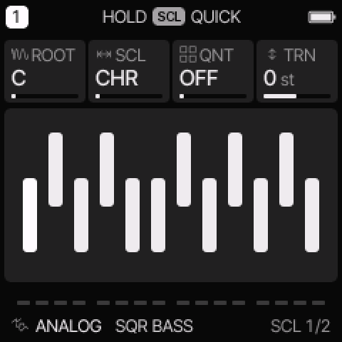</a>
<figcaption>SCL changes keyboard mapping and, in SEQ modes, playback mapping.</figcaption>
</figure>

The original stored step pitches remain available; playback mapping can change what is heard.
Available scales are CHR, MAJ, MIN, DOR, MIX, PEN, MPEN, HARM, PHRY, LYD,
LOC, MEL, BLUES, WHOLE, DIMHW, and DIMWH.
Use CHR for all chromatic pitches and MAJ or MIN to begin with a familiar scale.

CHRD turns one played key into a chord:
OFF, DIA3, DIA7, MAJ, MIN, DOM7, MAJ7, MIN7, SUS4, or POW.
DIA3 and DIA7 follow the selected scale.
VOIC selects CLOSE, OPEN, INV1, INV2, or +OCT spacing.

Start with QNT OFF and CHRD OFF when checking single-note entry.
A chord-key setting can turn one physical key into several stored tracker pitches.
It is independent of the CHORD playback mode on the arpeggiator.

## Arpeggiator

Press ARP for MODE, RATE, OCT, and GATE. ARP 2 has SWG, PROB, HOLD, and ORD.
Hold a chord to supply its notes. MODE selects their playback order.

| MODE | Playback pattern |
| --- | --- |
| OFF | Play normally, without arpeggiation. |
| UP | Move up through the note list. |
| DN | Move down through the note list. |
| UPDN | Move up, then down. |
| DNUP | Move down, then up. |
| RND | Choose random notes from the list. |
| ORD | Play notes in the order they were pressed, regardless of the ORD switch on ARP 2. |
| REPEAT | Repeat the last played note. |
| UP+8 | Ascend and add the first note above the selected octave range. |
| CONV | Alternate outer notes, moving inward. |
| DIVG | Begin toward the centre and move outward. |
| PINKY | Alternate moving notes with the top note. |
| THUMB | Alternate the bottom note with moving upper notes. |
| WALK | Move randomly to a neighbouring note in the list. |
| CHORD | Retrigger up to four held notes together and traverse the selected octaves. |

<figure>
<a href="images/engines/mode-arp.png">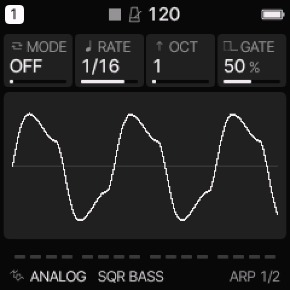</a>
<figcaption>ARP converts held notes into a clocked pattern.</figcaption>
</figure>

OCT sets octave range. RATE sets the clock division. GATE sets the fraction of each step that sounds.
SWG shifts alternating timings. PROB can skip triggers.
HOLD keeps the notes after you release the keys; the next played chord replaces that held set.
ORD=NOTE sorts pitches. ORD=PLAY retains their played order in the list.

Try UP at RATE 1/16 and OCT 1 before trying a more complex pattern.
The NES and PSG engine ARP controls are separate fast pitch effects inside those engines.

## Performance layers

Hold the indicated panel button and read the on-screen key map.
Keys used by the layer do not write tracker notes.
A double press can lock a layer so the button need not stay held.

| Layer | Main purpose | Knobs |
| --- | --- | --- |
| FX | Momentary performance effects; track mute shortcuts. | Four performance effect amounts. |
| GLO | Track mutes, held solos, unmute, fill, tap tempo, MIDI learn. | Track 1–4 levels. |
| SCL | Select root and chord settings with keys. | ROOT, SCL, CHRD, VOIC. |
| EDIT | Select an engine, preset, or initialization action. | Engine, sound number, favourites. |
| SEQ | Sequence tools such as clear, reverse, shift, random, or Euclidean fill. | LEN, DIV, SWING, GATE, or the active tool's controls. |
| REC | Recording settings and clear action. | Click, count-in, click level. |

FX effects normally last while the relevant keys are held.
SET layers change settings. OCT− can restore the layer's opening state where shown.
Check the footer before using a clear or initialization action.
SAVE held is the general undo/redo gesture for supported edits.

## Save pages

Press SAVE to reach sound and project storage.
From another page, its first action can be the quick user-sound save workflow.
Continue through the pages using the displayed page name.

| Page | Stores or selects |
| --- | --- |
| USER | A user sound: engine and sound settings. |
| PRESETS | Factory/user sound browser and favourites. |
| PHRASES | Built-in pattern suggestions for the selected track. |
| PROJECT | The complete current project: tracks, sounds, tracker library, and song. |
| TOOLS | Sequence clear and sound initialization actions. |

Loading a phrase suggestion changes notes. Loading a sound changes its sound settings.
A sound preset is not a complete song backup.
Use PROJECT to keep the arrangement, and the web editor's complete backup for a computer copy.
Follow [save, load, and backup procedures](USER_GUIDE.md#save-load-and-back-up).

## Settings menu and MIDI

Hold HOME to open the menu. Press HOME to leave it.
ALGORITHM selects a tab. PRESETS selects a row. Use the displayed control to change its value.

| Tab | Main settings |
| --- | --- |
| DISPLAY | Theme, display, scope, and HOME view options. |
| CONTROL | Hold timing, knob acceleration, latch, chord entry, and SELECT behavior. |
| AUDIO | Tuning, recording click/count-in, and audio settings. |
| MIDI | Input source, track/channel routing, and MIDI options. |
| SYSTEM | Device information and maintenance functions. |

MIDI input routing can use a four-channel block, the selected track, or per-track channels.
Clock source is a separate setting: receiving notes does not automatically select an external clock.
Set CLK to USB or TRS when that source must control transport timing.
Display changes made during playback can be saved after STOP.
The web editor's Light / dark button changes the web page, not this hardware display setting.

## When a control seems to do nothing

| Check | Reason |
| --- | --- |
| Is NOTE shown in the tracker? | NAV keeps the middle keys from entering notes. |
| Is the right track selected? | Sound edits normally apply to one track. |
| Is the track muted or its level low? | A correct sound can still be inaudible in the mix. |
| Is the engine control relevant to the selected model? | For example, pulse DUTY does not alter a noise voice. |
| Is modulation depth zero? | An LFO waveform alone does not move the sound. |
| Is LFO SYNC on? | Clock division overrides the free RATE control. |
| Is AY BUZZ set to FLAT? | B-RATE has no buzzer envelope to move. |
| Is Sega noise set to a fixed clock? | N-DIV affects linked noise only. |
| Is WAVE SCAN or RATE zero? | Automatic scan needs both speed and depth. |
| Is the sound FM6, YM, or DRUM? | Use its engine envelopes instead of common ADSR. |
| Is an external clock selected but stopped? | The sequencer waits for its timing source. |
| Is a phrase or instrument shared? | Editing it can change several references. |

For screen messages and storage limits, see [limits and messages](USER_GUIDE.md#limits-and-messages).
