# Yanfei user guide

This guide is for Yanfei firmware on the M-VAVE FM-1.
Yanfei is based on Felucca by Leo Kuroshita and Hügelton Instruments.
It covers sound selection, the tracker, song arrangement, and project storage.

## Contents

- [Visual guide](VISUAL_GUIDE.md)
- [Controls and terms](#controls-and-terms)
- [Select a sound](#select-a-sound)
- [Open the tracker](#open-the-tracker)
- [Use the four-track view](#use-the-four-track-view)
- [Make your first phrase](#make-your-first-phrase)
- [Edit a section of up to four bars](#edit-a-section-of-up-to-four-bars)
- [Edit notes and drums](#edit-notes-and-drums)
- [Set note duration](#set-note-duration)
- [Use instruments](#use-instruments)
- [Use chains](#use-chains)
- [Make an A–A–B–A song](#make-an-aaba-song)
- [Set chance, repeats, and timing](#set-chance-repeats-and-timing)
- [Use parameter locks](#use-parameter-locks)
- [Record while the phrase plays](#record-while-the-phrase-plays)
- [Save, load, and back up](#save-load-and-back-up)
- [Limits and messages](#limits-and-messages)

Use the [quick reference](TRACKER_QUICK_REFERENCE.md) for the control tables.
Start with the [visual guide](VISUAL_GUIDE.md) to find the controls and recognize each screen.
The pictures below show the y13 emulator. Your notes, sounds, and colors can differ.
Select a picture to open it at full size.

## Controls and terms

### Panel buttons and keyboard keys

The **EDIT button** is on the control panel.
The **EDIT key** is a key on the musical keyboard.
They have different functions.

**Press** means press and release.
**Hold** means keep the control pressed.

For a combination such as **SHIFT + RIGHT**:

1. Hold the SHIFT key.
2. Press the RIGHT key.
3. Release the SHIFT key.

For **SHIFT + OPTION + EDIT**, hold SHIFT and OPTION before you press EDIT.
Use this clone command in a section page, CHAIN, or SONG.
In separate phrase editing, open CHAIN first to clone a phrase.


<figure>
<a href="images/guide/keyboard.png">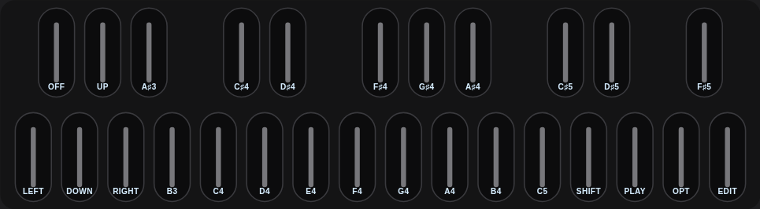</a>
<figcaption>The EDIT key is at the far right. It is separate from the panel EDIT button.</figcaption>
</figure>

### Tracker keyboard map

| Physical key position | Tracker function |
| --- | --- |
| F3, the leftmost key | LEFT |
| F#3 | OFF in NOTE mode |
| G3 | DOWN |
| G#3 | UP |
| A3 | RIGHT |
| A#3 through C#5 | Sixteen note-entry keys |
| D5 | SHIFT |
| E5 | PLAY |
| F5 | OPTION |
| G5, the rightmost key | EDIT |

These names identify physical key positions.
Octave changes do not move the tracker controls.

### Song terms

| Term | Meaning |
| --- | --- |
| Track | One of four parts that can play at the same time. |
| Row | One time position in a phrase. |
| Cell | One value at a row and column. |
| Phrase | A pattern with up to sixteen rows. |
| Instrument | A stored sound, with its engine and sound settings. |
| Chain | A list of phrases to play in order. |
| Link | One phrase reference and transpose value in a chain. |
| Section | One song row, with a chain reference for each track. |
| Reference | The number of an existing phrase, chain, or instrument. |
| Clone | A new copy that you can change separately. |
| Project | The song, phrases, chains, instruments, and their settings. |

The display uses hexadecimal numbers.
After `09`, the numbers continue as `0A`, `0B`, `0C`, `0D`, `0E`, and `0F`.
A full phrase has rows `00` through `0F`.

## Select a sound

Do this before you enter the tracker.

1. Stop playback.
2. Press the ENV button.
3. Press the HOME button.
4. Turn ALGORITHM to select a track.
5. Turn PRESETS to select a sound.
6. Play the keyboard to hear the sound.


<figure>
<a href="images/guide/home.png">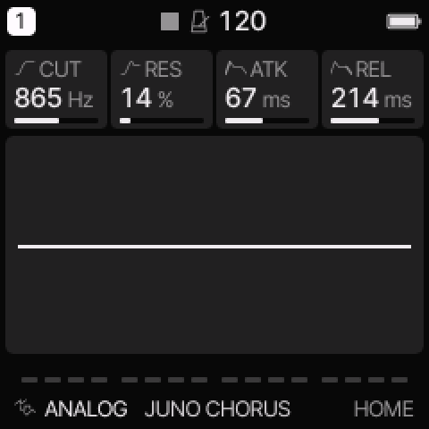</a>
<figcaption>HOME shows the current sound at the bottom. The four knobs change the four displayed settings.</figcaption>
</figure>

The preset list includes sounds from all twelve engines.
The display shows the selected engine and preset.
KNOB 1 through KNOB 4 change the sound parameters shown on HOME.

| Engine | Main use |
| --- | --- |
| ANALOG | Filtered oscillator sounds, basses, and leads |
| NES | Console pulse tones, triangle bass, and noise |
| DMG | Handheld pulse, wave, and noise sounds |
| PSG | AY or Sega square tones and noise |
| TRIO | SID-style oscillators, ring modulation, and filtering |
| FM6 | Six-operator FM and DX-style sounds |
| YM | Four-operator YM2612-style FM, as used in the Sega Genesis |
| WAVE | Wave scanning and changing digital tones |
| PHASE | Phase-distortion sounds |
| STRING | Plucked and resonating strings |
| MODAL | Bells, bars, plates, and membranes |
| DRUM | Eight synthesized drum lanes |

### PSG chip selection

1. Select a PSG sound.
2. Press the EDIT button until the CHIP page appears.
3. Turn KNOB 1 to select AY or SEGA.

Pause between EDIT button presses to prevent its double-press shortcut.
On HOME, AY shows TONE2, N-MIX, BUZZ, and B-RATE.
SEGA shows TONE2, N-MIX, NOISE, and TONE.


<figure>
<a href="images/guide/psg-sega.png">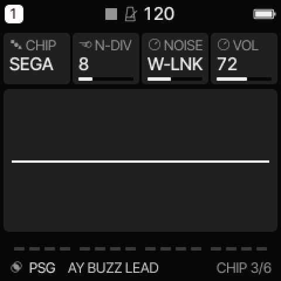</a>
<figcaption>CHIP is the AY/Sega selector. KNOB 1 changes it.</figcaption>
</figure>

### WAVE banks

1. Select a WAVE sound.
2. Press the EDIT button until BANK appears.
3. Turn the knob below BANK to select BASIC, COLOR, PPG, ESQ, or VS.

Each bank contains four waves.
POS moves between them.
RATE and SCAN control automatic movement.
The VS bank uses the same linear scan as the other banks.


<figure>
<a href="images/guide/wave.png">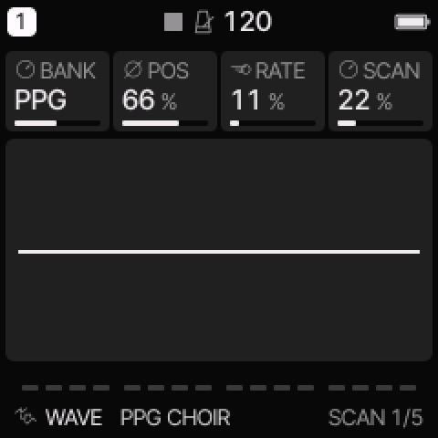</a>
<figcaption>WAVE bank selection on EDIT.</figcaption>
</figure>

## Open the tracker

SEQ cycles through the tracker, STEP, DETAIL, and AUTOMATION pages.
Pause between SEQ presses to prevent its double-press shortcut.
On a fresh boot, the tracker opens in ALL.
It keeps your selected view when you leave and return during the same session.
The tracker has four views:

| View | How to identify it |
| --- | --- |
| ALL | An ALL heading, with four track columns. |
| PHRASE | Note columns N1 through N4, or drum columns KD through RM. |
| CHAIN | A CHAIN heading, with PHRASE and TRANSPOSE columns. |
| SONG | A SONG heading, with four track columns. |


<figure>
<a href="images/guide/phrase.png">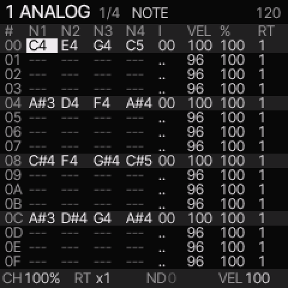</a>
<figcaption>Use the column headings to identify PHRASE. SHIFT + UP switches between it and ALL.</figcaption>
</figure>

The PHRASE heading shows the engine. In section editing, it also shows the page number.
In separate phrase editing, it shows the phrase number.
It does not show the word TRACKER.

In PHRASE and ALL, the bottom strip shows four values for the selected row:

| Label | Value |
| --- | --- |
| CH | Chance or condition |
| RT | Ratchet repeat count |
| ND | Nudge timing offset |
| VEL | Velocity |

Dim values do not apply to the current row or settings.
Short messages temporarily replace this strip.
KNOB 1 through KNOB 4 still change the sound on this page.
Use DETAIL to edit the four note values with those knobs.

To reach PHRASE:

1. Stop playback.
2. Press SEQ until one of these four views appears.
3. In SONG, select a filled chain cell.
4. In SONG, press SHIFT + RIGHT to open that chain.
5. In CHAIN, select a filled phrase cell.
6. In CHAIN, press SHIFT + RIGHT to open that phrase.

In ALL, press SHIFT + UP to open PHRASE.
If PHRASE is already open, no further navigation is required.
Opening an empty chain or song cell can create a new item.

## Use the four-track view

1. Open SEQ.
2. If PHRASE is open, hold SHIFT and press UP.

ALL is the default after a restart.

In section editing, the heading shows ALL, the section number, and the page number.
In separate phrase editing, it shows the selected track and phrase number.

<figure>
<a href="images/guide/all.png">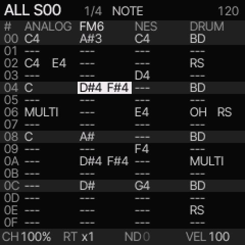</a>
<figcaption>The white cell is the edit position. The underlined engine heading marks its track.</figcaption>
</figure>

The four columns show tracks 1 through 4, from left to right.
Each column heading shows the track's current engine.

| Cell | Meaning |
| --- | --- |
| One pitch, such as C4 | The row has one note. |
| Two pitches | The row has two notes. Each pitch includes its octave. |
| A chord name, such as Cm7 | The row has three or four notes that match a known chord. |
| MULTI | The row has several notes or drum hits. There is no chord label for this set. |
| One or two drum names | The row has one or two drum lanes. |
| --- | Blank row. A held note can continue. |
| OFF | Release held notes. |
| === | Tie. |
| Empty cell | The row is past this track's phrase length. |

Chord labels use sharp names. M7 means major seventh. m7 means minor seventh.
A plus sign means augmented. dim means diminished.
An inversion has the same chord label. The label does not show its bass note.
An ambiguous set uses the chord whose root is the lowest note, if possible.
The label does not change the stored notes.

Use LEFT and RIGHT to select a track. Use UP, DOWN, or SELECT to select a row.
ALGORITHM also selects a track. In section editing, the row stays selected.
The bottom strip shows CH, RT, ND, and VEL for the selected cell.

Press REC once to enable note entry. Play one note or hold several note keys together.
This replaces the selected cell's notes. Release all note keys to advance one row.
Use this method for available drum hits, too.
The first two drum keys are tracker controls. Use the detailed lane view for those lanes.

| Control in ALL | Action |
| --- | --- |
| PRESETS | Transpose all notes in the cell by semitones. |
| EDIT + LEFT or RIGHT | Transpose all notes by one semitone. |
| EDIT + UP or DOWN | Transpose all notes by one octave. |
| EDIT tap on a blank cell | Insert C4, or a kick on a drum track. |
| EDIT tap on a filled cell | Copy the row. |
| SHIFT + OPTION | Copy the row. |
| SHIFT + EDIT | Paste the row into the selected track and row. |
| OPTION + EDIT | Clear the row's notes, instrument reference, gate, and OFF flag. |
| OPTION + SELECT | Set the row gate. |
| PLAY | Repeat the selected section; in separate phrase editing, repeat all four edit phrases. |
| SHIFT + PLAY | Play the song from the selected song row. |
| SHIFT + UP | Switch back to the detailed PHRASE view. |

Transposition keeps the intervals between notes. It stops at the MIDI pitch limits.
For drums, use note entry or the detailed lane view to change the hits.
To change one note within a chord, switch to PHRASE and select its note column.
The sound knobs keep their engine controls in both views.

Rows show phrase positions. Tracks with different lengths or divisions can have different playhead positions.
A line below each playing cell shows that track's playhead.
Chain and song playback show the current phrase for each track.
Stop chain or song playback before you edit.


## Make your first phrase

These instructions assume that playback has stopped.

1. [Open PHRASE](#open-the-tracker).
2. Turn ALGORITHM to select track 1.
3. Press REC until NOTE appears.
4. Turn SELECT to row `00`.
5. Press a note-entry key.
6. Release the note-entry key.

The note appears in the row.
The cursor moves to the next row after you release all note-entry keys.

To add more notes:

1. Turn SELECT to row `04`.
2. Enter another note.
3. Turn SELECT to row `08`.
4. Enter another note.
5. Turn SELECT to row `0C`.
6. Enter another note.

To hear the phrase:

1. Press REC until NAV appears.
2. Press the PLAY button.

In section editing, all tracks repeat the selected section.
In separate PHRASE editing, the selected track repeats its phrase.
Press PLAY again to stop.

### Play all four tracks

1. Stop playback.
2. Press the ENV button.
3. Press the PLAY button.

Outside the tracker, PLAY repeats the four selected phrases together.
Inside the tracker, its current view controls what PLAY starts.

| View | PLAY starts |
| --- | --- |
| ALL or PHRASE in section editing | The selected section, repeated |
| ALL in separate phrase editing | The four edit phrases, repeated |
| PHRASE in separate phrase editing | The selected track's phrase, repeated |
| CHAIN | The selected chain on the selected track, repeated |
| SONG | The song from the selected section, through its end |

CHAIN playback starts at the selected link.
After the last link, it repeats from the first link.
SHIFT + PLAY starts the song from the selected song row.
A fixed section ends after its set number of bars. Shorter tracks repeat or wait,
as set for each track. In AUTO, the next section starts after all tracks finish.

### Set tempo

1. Hold the GLO button.
2. Turn SELECT to set BPM.
3. Release the GLO button.

## Edit a section of up to four bars

A new project starts with a four-bar section. At DIV 1/16, with 16 rows in each
phrase, this is 64 rows. The screen shows 16 rows at a time.
The page indicator shows `1/4`, `2/4`, `3/4`, or `4/4`.
Row numbers are hexadecimal: `00` through `3F`.


<figure>
<a href="images/guide/page4.png">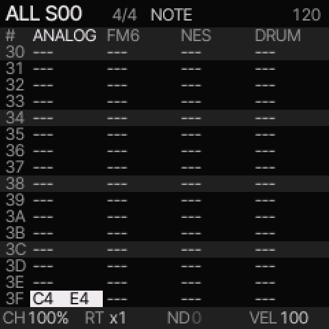</a>
<figcaption>The page number and row labels show your position in the section.</figcaption>
</figure>

Use UP, DOWN, or SELECT to move through the rows. The screen changes page when
you cross a page boundary. Movement stops at the first or last row.
Hold SHIFT and turn SELECT to change page. OPTION + UP or DOWN also changes page.
The row within the page stays selected.

ALL and detailed PHRASE can both edit section pages. SHIFT + UP switches between
these views. In SONG, SHIFT + UP opens the selected section in ALL.
In section editing, PLAY repeats that section. SHIFT + PLAY starts the arrangement.
Stop playback before you change section notes or references.
REC switches between NAV and NOTE entry. Use separate phrase editing for live recording.

### Set the section length

1. Stop playback.
2. Open a section page or select a row in SONG.
3. Hold SHIFT and OPTION.
4. Turn SELECT to set one, two, three, or four bars.
5. Release the keys.

Turning below one bar selects AUTO. Old projects load with AUTO to keep their
previous timing: all tracks finish their chains before the next section starts.
Use a bar length for the new fixed section boundary.
Shortening a section does not erase notes on later pages.

A bar has four musical beats. The section clock is independent of track DIV,
SWING, and phrase LEN. With another division or a shorter phrase, a page can take
less or more than one bar. The section still ends at the set number of beats.
Notes after this boundary do not play in that pass.

### Repeat a shorter track, or let it wait

1. Stop playback and select the track in a section page or SONG.
2. Hold OPTION.
3. Turn PRESETS right for REPEAT, or left for WAIT.
4. Release OPTION.

REPEAT plays the track's chain again until the section ends.
WAIT plays it once, then releases its notes and waits silently.
SONG shows R or W beside each track number. New fixed sections use REPEAT.
An empty track stays silent. An empty page before a later filled page takes
16 silent rows. All tracks start the next section together.
AUTO uses the previous wait behavior.

### Copy or make a variation of a page

These commands affect the selected track's page:

| Control | Action |
| --- | --- |
| SHIFT + OPTION + LEFT | Copy the page reference. |
| SHIFT + OPTION + RIGHT | Paste the reference into this page. |
| SHIFT + OPTION + EDIT | Clone this page for separate note edits. |

A pasted page shares its notes and automation with the source. Clone it before
you change notes that must differ. A clone still uses the same instrument numbers.
If two sections share a chain, clone that chain in SONG before you change its pages.

The project has 32 shared phrases. Each page uses one phrase for each track that
has notes. Browsing a blank page uses no new phrase. Copying a reference also uses
no new phrase. A new written page or a clone needs a free phrase.
The display reports PHRASE BANK FULL when none is available.

SHIFT + OPTION and SHIFT + EDIT still copy and paste one row.
Copying a whole section in SONG also copies its length and repeat settings.

### Edit one phrase separately

Press SHIFT + DOWN in ALL or PHRASE to switch between section editing and separate
phrase editing. The message says SECTION EDIT or PHRASE EDIT.
In separate phrase editing, OPTION + UP or DOWN selects a phrase ID. PLAY repeats
the edit phrases in ALL, or the selected phrase in PHRASE. REC has its previous
NAV, NOTE, ARM cycle. Opening a phrase from CHAIN also selects this mode.

## Edit notes and drums

### Select a row or cell

- Turn SELECT to move between rows.
- Press LEFT or RIGHT to select a column.
- Press UP or DOWN to move one row.
- Press OPTION + LEFT or OPTION + RIGHT to select a track.
- Press OPTION + UP or OPTION + DOWN to change section page.
- In separate phrase editing, these keys select another phrase number.

Stop playback before you change the selected phrase.

### Change a note

1. Select its note cell.
2. Turn PRESETS to change its pitch.

Alternatively, press EDIT + LEFT or EDIT + RIGHT to change one semitone.
Press EDIT + UP to raise one octave.
Press EDIT + DOWN to lower one octave.

Press the EDIT key on an empty note cell to insert a note.
Pressing EDIT on a filled note cell copies its pitch for later entry.


### Enter a chord

1. Press REC until NOTE appears.
2. Select the row.
3. Press up to four note-entry keys together.
4. Release all note-entry keys.

All four pitches share the row's instrument, velocity, timing, and duration.
The sound's voice mode can limit how many pitches you hear.
For chords, select POLY with the VCE control on the VOICE page.
Use the EDIT button to reach that page.

The four tracks share eight voices.
The firmware can stop an older voice when this limit is reached.

### Clear a note

1. Select the note cell.
2. Press OPTION + EDIT.

The remaining chord notes move left.
If no notes remain, the row becomes blank.
A blank row does not stop an earlier held note.

### Enter drum hits

<figure>
<a href="images/guide/drums.png">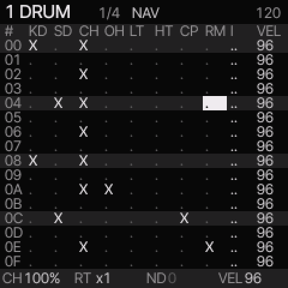</a>
<figcaption>On a DRUM track, PHRASE shows one column per drum lane.</figcaption>
</figure>

1. Select a DRUM sound.
2. [Open PHRASE](#open-the-tracker).
3. Select a row and drum-lane column.
4. Press the EDIT key to switch the hit on or off.

| Column | Drum lane |
| --- | --- |
| KD | Kick drum |
| SD | Snare drum |
| CH | Closed hi-hat |
| OH | Open hi-hat |
| LT | Low tom |
| HT | High tom |
| CP | Clap |
| RM | Rim |

Several lanes can play on one row.
EDIT + UP sets the selected hit's accent.
EDIT + DOWN removes its accent.
An accented hit uses velocity 127.
Other hits use the row's VEL value.

## Set note duration

### Blank rows, HOLD, OFF, and ties

| Item | Result |
| --- | --- |
| Blank row | No new note or note-off instruction. |
| HOLD gate | Keep the note until another note, OFF, section completion, or stop. |
| Finite gate | Release the note after a specified part of its step. |
| OFF | Release the notes held by this track. |
| Tie, shown as `===` | Continue the previous note without a new trigger. |

A sound can decay to silence while its note remains held.
HOLD does not add a pitch slide.

### Set a row gate

<figure>
<a href="images/guide/gate.png">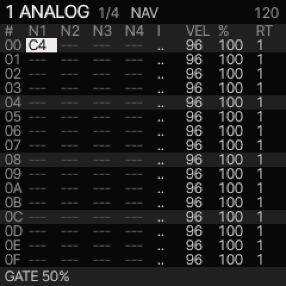</a>
<figcaption>The gate value appears at the bottom while you change it with OPTION + SELECT.</figcaption>
</figure>

1. Select the note row in PHRASE.
2. Hold the OPTION key.
3. Turn SELECT until the footer shows the required gate.
4. Release the OPTION key.

For example, **GATE 50%** releases the note halfway through its step.
Turn left until **GATE HOLD** appears to remove the timed release.
A very short finite gate can display `0%`; this differs from HOLD.

With ratchet repeats, HOLD uses a full subdivision for each hit.

### Insert OFF

1. Press REC until NOTE appears.
2. Select the row where the note must stop.
3. Press F#3.

The row shows OFF.
The cursor advances one row.
OFF replaces the row's notes.

### Insert or extend ties

To insert a tie in NOTE mode, press EDIT + F#3.

To set a note's length with ties:

1. Select the note row in PHRASE.
2. Hold the EDIT key.
3. Turn SELECT to extend or shorten the note.
4. Release the EDIT key.

Extension stops at the next occupied row or the phrase end.
A tie can extend a note that has a finite gate.

## Use instruments

The I column selects an instrument number from `00` through `0F`.
An instrument contains an engine and its sound settings.
It also contains the complete patch for an FM6 sound.

`..` means use the last I value above this row.
If no earlier I value exists, the phrase's default instrument applies.

### Assign a separate sound

Stop playback first.
On a new project, instruments `00` through `03` are the initial track sounds.

1. Select the required phrase row.
2. Move to its I column.
3. Turn PRESETS to an instrument number that the project does not use.

The unused instrument starts as a copy of the selected sound.

4. Press SHIFT + RIGHT to open sound editing.
5. Turn PRESETS to select the required sound.
6. [Return to PHRASE](#open-the-tracker).

Rows with the same instrument number use the same sound.
An edit to that instrument changes all its uses.
To keep the original sound, assign another unused instrument number first.

The track's timing stays the same when the instrument changes.
Knob changes during playback are temporary.
Stop playback before you make sound edits that the project must keep.

## Use chains

### Open a chain

1. Stop playback.
2. Open PHRASE.
3. Press SHIFT + LEFT.


<figure>
<a href="images/guide/chain.png">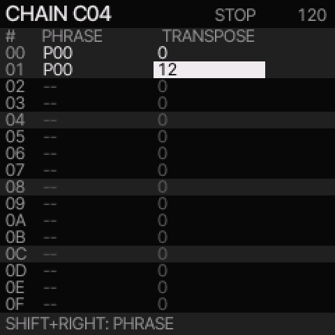</a>
<figcaption>Each link selects a phrase and a transpose value. A value of 12 raises playback by one octave.</figcaption>
</figure>

CHAIN shows phrase references in play order.
For example, two links to P00 play that phrase twice.

### Add another phrase

1. Select an empty PHRASE cell in CHAIN.
2. Press the EDIT key.

A new phrase number appears.

3. Press SHIFT + RIGHT to open the new phrase.
4. Enter its notes.
5. Press SHIFT + LEFT to return to CHAIN.

To use an existing phrase, select its number with PRESETS instead of creating a new phrase.

### Transpose one link

1. Select the link's TRANSPOSE cell.
2. Turn PRESETS to set the transpose value.

The range is minus 24 through plus 24 semitones.
Transpose changes playback pitches without changing the phrase's stored notes.
It does not transpose drum hits.

### Copy a chain link

1. Select the source link.
2. Press SHIFT + OPTION.
3. Select the destination link.
4. Press SHIFT + EDIT.

Both links now refer to the same phrase.
An edit to that phrase changes both links.

## Make an A–A–B–A song

This procedure assumes that section `00` already contains your first arrangement, called A here.
Yanfei uses row numbers rather than stored A/B section names.


<figure>
<a href="images/guide/song.png">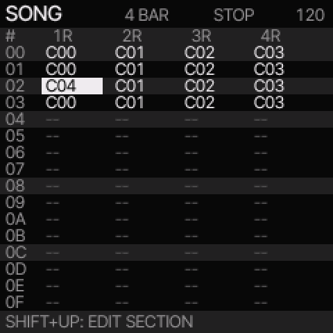</a>
<figcaption>Here, rows 00, 01, and 03 use C00 on track 1. Row 02 uses C04.</figcaption>
</figure>

### Repeat section A

1. Stop playback.
2. Press the GLO button to open SONG.
3. Select song row `00`.
4. Press SHIFT + OPTION to copy the whole section.
5. Select row `01`.
6. Press SHIFT + EDIT.
7. Select row `02`.
8. Press SHIFT + EDIT.
9. Select row `03`.
10. Press SHIFT + EDIT.

All four rows now use the same chain references.
The section copy includes all four tracks, its length, and its repeat settings.

### Make section B

1. Select row `02`.
2. Select the track column that must change.
3. Press SHIFT + OPTION + EDIT.

The selected cell now refers to a new chain.
The new chain still uses the original phrases.

4. Press SHIFT + RIGHT to open the new chain.
5. Select the PHRASE cell that must change.
6. Press SHIFT + OPTION + EDIT.

The link now refers to a new phrase.
The new phrase has separate notes, gates, and automation.
Its instrument numbers remain shared.

7. Press SHIFT + RIGHT to open the new phrase.
8. Change its notes.
9. Press the GLO button to return to SONG.

Repeat the chain and phrase clone steps for each additional part that must differ.
Only the selected track's chain changes with a chain clone.

### Play the arrangement

1. Select song row `00`.
2. Press PLAY.

The song plays A, A, B, then A.
It stops after the last section.
An empty song cell is silent for that track in that section.

### Copy one song cell

1. Select a filled song cell.
2. Press the EDIT key to copy its chain reference.
3. Select the destination cell.
4. Press SHIFT + EDIT.

This copies one reference.
SHIFT + OPTION copies all four cells in a section instead.

## Set chance, repeats, and timing

In PHRASE, select VEL, %, or RT and turn PRESETS to change the value.

| Field | Meaning |
| --- | --- |
| VEL | Velocity, from 1 through 127. |
| % | Chance, from 0% through 100%, followed by cycle and FILL conditions. |
| RT | One through four triggers within the step. |

For example, `1:2` plays on the first of every two cycle passes.
In PHRASE, conditions count phrase passes.
In CHAIN and SONG, they count chain passes.
Chance and conditions are alternative settings in the same field.
They are not independent probability controls.

FILL plays while the fill control is held.
!FILL plays while it is released.
To use the fill control, hold the GLO button and the keyboard's E4 key.

### Use DETAIL

1. Select the phrase row.
2. Press SEQ until DETAIL appears.

| Knob | Field |
| --- | --- |
| KNOB 1 | CHANCE or condition |
| KNOB 2 | RATCH, the repeat count |
| KNOB 3 | NUDGE, the timing offset |
| KNOB 4 | VEL |

On DETAIL, turn PRESETS to select a row.
These fields also apply to drum rows.


<figure>
<a href="images/guide/detail.png">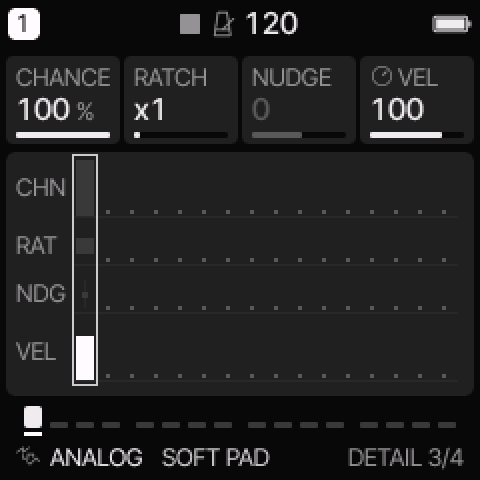</a>
<figcaption>PRESETS selects the row. KNOB 1 through KNOB 4 change the four note fields.</figcaption>
</figure>

### Apply a timing offset

1. Open AUTOMATION with the SEQ button.
2. Turn KNOB 1 to select QUANTIZE.
3. Turn KNOB 4 to set it to OFF.
4. Return to DETAIL.
5. Select the note row with PRESETS.
6. Set RATCH to one.
7. Turn KNOB 3 to set NUDGE.

Negative NUDGE values play early.
Positive values play late.
Each unit is one sixteenth of a step.
The range is minus eight through plus seven units.

## Use parameter locks

A **lock** changes an eligible sound parameter for one step.
An **AUTO event** holds its value until another event, the loop restart, or stop.
For example, a lock can change filter cutoff for one note.

### Add a lock

1. Stop playback.
2. Open AUTOMATION with the SEQ button.
3. Turn KNOB 1 to select + ADD.
4. Turn KNOB 2 to select the step.
5. Turn KNOB 3 to select a sound parameter.
6. Press OCT+ to add the lock.
7. Turn KNOB 4 to set its value.

AUTOMATION uses step numbers starting at 1.
Tracker row `00` is step 1 in this list.

On an existing lock, OCT+ changes LOCK to AUTO.
Press OCT+ again to change AUTO to LOCK.
The EDIT button deletes the selected event.
PLAY at the top of this list enables or disables automation.
It does not start the transport.

Parameter locks support eligible sound, envelope, mix, and effect settings.
They do not switch engines.
Use the I column for instrument changes.

## Record while the phrase plays

1. Stop playback.
2. Open PHRASE. Press SHIFT + DOWN if needed to select PHRASE EDIT.
3. Select the track.
4. Press REC until ARM appears.
5. Press PLAY.
6. Play the note-entry keys.
7. Press PLAY to stop.
8. Press REC until NAV appears.

Recording uses the playback position.
It does not also enter notes at the edit cursor.
Record phrases separately from chain and song playback.

## Save, load, and back up

### Save a project

1. Stop playback.
2. Press SAVE until PROJECT appears.
3. Turn KNOB 1 to select a slot.
4. Turn KNOB 4 right to select SAVE.
5. Press OCT+.


<figure>
<a href="images/guide/project.png">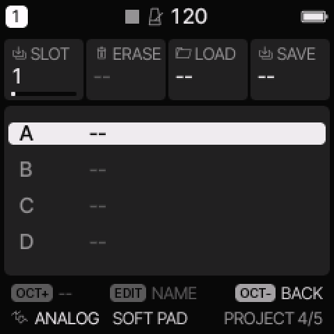</a>
<figcaption>Use PROJECT for the whole song. USER saves one sound.</figcaption>
</figure>

If OVERWRITE appears, OCT+ confirms replacement of that slot.
OCT− cancels.
The NAME screen appears before the write.

6. Set the name, if required.
7. Press OCT+ to write the project.


<figure>
<a href="images/guide/name.png">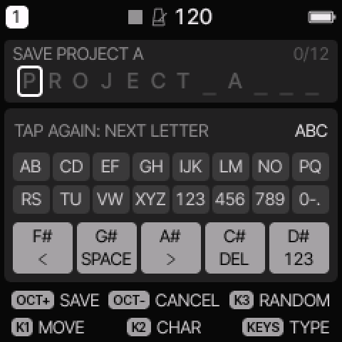</a>
<figcaption>OCT+ writes the named project. OCT− cancels.</figcaption>
</figure>

On NAME, KNOB 1 moves the text cursor.
KNOB 2 changes a character.
OCT− cancels without writing.

PROJECT saves the whole tracker library and arrangement.
SAVE > USER saves a sound; it is not a complete song save.

### Load a project

Loading replaces the current work.
Save the current project first if you must keep it.

1. Stop playback.
2. Press SAVE until PROJECT appears.
3. Turn KNOB 1 to select the slot.
4. Turn KNOB 3 right to select LOAD.
5. Press OCT+.

### Undo or redo

1. Stop playback.
2. Hold the SAVE button until the undo message appears.
3. Release SAVE.

Hold SAVE again to redo the change.
There is one undo action, not a history list.
For a phrase edit, return to that phrase before you undo it.
Undoing a new reference retains its created phrase or chain in the library.

### Save a complete backup to a computer

Use the [current web editor](https://izumoe.github.io/yanfei/webapp/editor/) in Chrome or Edge.
An older editor can reject the larger tracker projects.
Connect the FM-1, stop playback, open Projects, and select Save backup.
For a local copy of the editor, use the procedure below.

To open the supplied editor, run this command from the repository folder:

```sh
python3 -m http.server 8000 --directory web
```

1. Open <http://localhost:8000/editor.html> in Chrome or Edge.
2. Connect the FM-1 by USB.
3. Select Connect in the editor.
4. Select the FM-1 MIDI port if the browser asks.
5. Stop playback.
6. Select the Projects tab.
7. Select Save backup under Complete backup.
8. Keep the downloaded file.

The backup includes current work, saved projects, sound banks, and settings.
It includes the available user sample data.
Yanfei reserves the first two sample slots for projects.
Those slots are not available for sample upload or backup.

To restore a backup, select Restore backup and choose the file.
Restoration replaces current work and stored data.
Keep USB connected until restoration finishes.

Use the device or emulator to edit tracker instruments and song sections.
The desktop sequencer does not expose all tracker fields.

### Load older core projects

The first tracker entry converts the four working patterns into phrase pages.
It keeps notes, drum hits, timing, automation, and FM6 patches.
Old rests become OFF instructions where required.

Save the converted project to another slot to retain the original.
Older song orders do not convert into tracker song sections.
Rebuild those orders in SONG.
Core8 tracker projects require core8 firmware.

## Limits and messages

| Item | Project limit |
| --- | --- |
| Tracks | 4 |
| Phrases | 32, with up to 16 rows each |
| Chains | 16, with up to 16 links each |
| Song sections | 32 |
| Instruments | 16 |
| Automation events and locks | 128 shared records |
| Saved projects | 4 slots |
| Sounding voices | 8 shared voices, with additional engine limits |

| Display or problem | Action |
| --- | --- |
| NAV; keyboard makes no sound | Press REC until NOTE appears, or open a sound page. |
| Only one track plays | PHRASE playback uses the selected track. Use SONG or play outside the tracker. |
| STOP TO EDIT | Stop playback or recording before you edit. |
| STOP TO RECORD | Stop chain or song playback before you record a phrase. |
| PHRASE BANK FULL | Reuse an existing phrase. Another clone cannot fit. |
| CHAIN BANK FULL | Reuse an existing chain. Another chain cannot fit. |
| AUTOMATION FULL | Remove unneeded events or locks before you add more. |
| RETURN TO EDITED PHRASE | Select the phrase that contains the edit, then hold SAVE. |
| NO NOTE | Select a row with a note or drum hit before you change its details. |
| QUANTIZE IS ON | Set QUANTIZE to OFF in AUTOMATION to hear NUDGE. |
| An edit also changes section A | The sections share a phrase or instrument. Clone or assign a separate instrument before editing. |
| A note continues through blank rows | Use OFF or a finite row gate. |

Clearing a reference removes its use at that location.
It does not delete the phrase or free its number.

Core8 does not have dedicated tracker pitch-slide, vibrato, or arpeggio command columns.
Use the sound controls and existing automation where applicable.

For implementation and validation details, see [Tracker technical notes](TRACKER.md).
