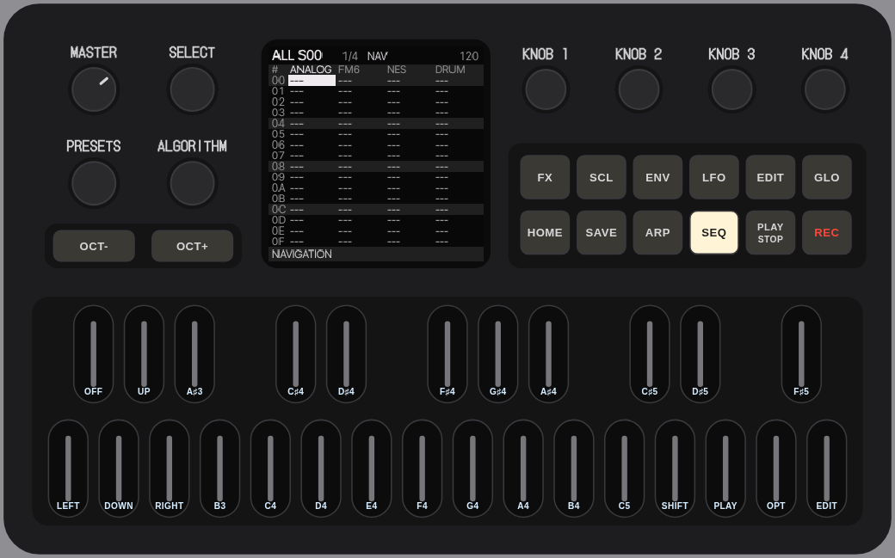
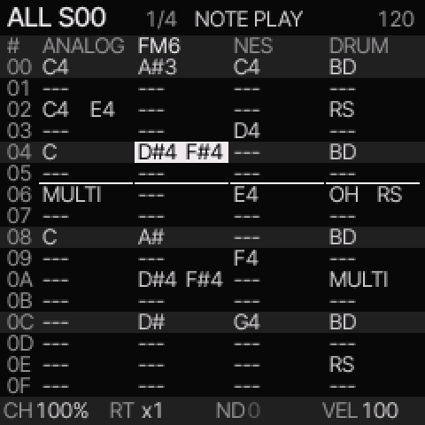
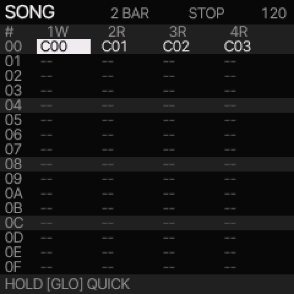

# Yanfei visual guide

Use this guide to find the controls and recognize each screen.
The pictures come from the y13 browser emulator. Your notes, colors, and sound names can differ. Select a picture to open it at full size.
For all procedures, use the [user guide](USER_GUIDE.md). For shortcuts, use the [control reference](TRACKER_QUICK_REFERENCE.md).

- [Find the controls](#find-the-controls)
- [Find your place on the screen](#find-your-place-on-the-screen)
- [Enter notes and hear them](#enter-notes-and-hear-them)
- [Move through four bars](#move-through-four-bars)
- [Edit each note or drum lane](#edit-each-note-or-drum-lane)
- [Make a song](#make-a-song)
- [Set note timing](#set-note-timing)
- [Save the whole project](#save-the-whole-project)
- [Use the browser aids](#use-the-browser-aids)

## Find the controls

<figure>

<figcaption>The emulator panel with tracker labels enabled. Use the printed control names on your FM-1.</figcaption>
</figure>

| Control | Start here |
| --- | --- |
| SEQ button | Open the tracker. |
| REC button | Enable note entry. In section editing, press again to return to navigation. |
| SELECT knob | Move between rows. Hold the SHIFT key to change page. |
| ALGORITHM knob | Select a track. |
| PRESETS knob | Change the selected tracker value. On HOME, select a sound. |
| KNOB 1 through KNOB 4 | Change the displayed sound settings; on DETAIL, change the note settings. |
| GLO button | Open the song arrangement after tracker activation. |
| SAVE button | Open the save pages. PROJECT saves the whole song. |

The **EDIT button** is in the panel's top row. It opens sound settings.
The **EDIT key** is the rightmost keyboard key. It edits tracker cells.
SHIFT and OPTION in these instructions are keyboard keys.

### Find the tracker keys

<figure>

<figcaption>The keyboard positions stay fixed when you change octave. OPT on this picture means OPTION.</figcaption>
</figure>

| FM-1 key position | Tracker control | Computer key in the emulator |
| --- | --- | --- |
| F3, leftmost key | LEFT | Z |
| F#3 | OFF in NOTE mode | S |
| G3 | DOWN | X |
| G#3 | UP | D |
| A3 | RIGHT | C |
| D5 | SHIFT | R |
| E5 | PLAY | Y |
| F5 | OPTION | U |
| G5, rightmost key | EDIT | O |

The sixteen keys from A#3 through C#5 enter notes in NOTE mode.
Hold a modifier before you press the other key. For example, hold SHIFT, press UP, then release SHIFT.
Computer arrow keys turn SELECT and ALGORITHM.

## Find your place on the screen

Press SEQ. On a fresh boot, ALL opens.
Pause between SEQ presses; a quick double press opens another control layer.

<figure>

<figcaption>ALL shows the four tracks together. The white cell is the edit position. In this example, FM6 is the selected track.</figcaption>
</figure>

Read the screen from top to bottom:

1. **ALL S00**: you are editing song section `00`.
2. **1/4**: page one of four.
3. **NOTE**: the note keys can write into the selected cell. **NAV** means navigation.
4. **120**: tempo in beats per minute.
5. **Four engine headings**: tracks 1 through 4, from left to right. The selected heading is underlined.
6. **00 through 0F**: the sixteen rows on this page. The numbers are hexadecimal.
7. **CH, RT, ND, VEL**: chance, ratchet count, timing offset, and velocity for the selected row.

A message can temporarily replace the bottom values.
A thin line below a cell marks playback. The white edit cell can be elsewhere.

### Change view

| You want to… | Control |
| --- | --- |
| See all tracks or individual note columns | SHIFT + UP switches ALL and PHRASE. |
| Open the current chain | SHIFT + LEFT from ALL or PHRASE. |
| Open SONG | GLO button, or SHIFT + LEFT from CHAIN. |
| Edit the selected song section | SHIFT + UP from SONG. |
| Open a chain from SONG, or a phrase from CHAIN | SHIFT + RIGHT. |

## Enter notes and hear them

Use an empty row. Save existing work first if you need to keep it.

1. Open ALL with SEQ.
2. Use LEFT or RIGHT to select a track.
3. Turn SELECT to choose a row.
4. Press REC once. The heading shows NOTE.
5. Press a note key, or hold up to four note keys together.
6. Release all note keys. The cursor advances one row.
7. Press PLAY to hear the section. Press PLAY again to stop.

<figure>

<figcaption>The example contains single notes, two-note cells, chords, and drum hits. PLAY repeats the selected section.</figcaption>
</figure>

A single note shows its pitch. Two notes show two pitches.
A larger set shows a chord name when it matches a known chord, or MULTI.
The stored pitches stay the same when the display shows a chord name.
Use SHIFT + UP to see them separately.

## Move through four bars

A new section has four pages. At DIV 1/16 and a phrase length of sixteen rows,
each page takes one bar. Turn SELECT past row `0F` to reach the next page.
Hold SHIFT and turn SELECT to change page while keeping the row position.

<figure>

<figcaption>4/4 means page four of four. The last row, 3F, is row 64 when counted from one.</figcaption>
</figure>

Hold SHIFT and OPTION, then turn SELECT to set one through four bars.
Shortening a section keeps the notes on its later pages.
At another DIV or a shorter phrase length, a page can take a different amount of time.
The section still ends at its set number of beats.

To copy a page, hold SHIFT and OPTION, then press LEFT.
At the destination page, hold SHIFT and OPTION, then press RIGHT.
This pastes a shared reference. To make separate note edits, press SHIFT + OPTION + EDIT to clone it.
If two sections share a chain, clone that chain in SONG before you change its pages.

## Edit each note or drum lane

### Melodic notes

Press SHIFT + UP from ALL to open PHRASE.

<figure>

<figcaption>Each row holds up to four pitches. I selects its instrument. The other values apply to the whole row.</figcaption>
</figure>

Use LEFT and RIGHT to select a column. Turn PRESETS to change the value.
Hold EDIT and press LEFT or RIGHT to move a pitch by one semitone.
Hold EDIT and press UP or DOWN to move it by one octave.
In ALL, these pitch edits transpose the whole chord.

### Drum lanes

Select a DRUM track, then open PHRASE with SHIFT + UP if needed.

<figure>

<figcaption>X marks a hit. An exclamation mark marks an accent. I and VEL are shared by the row.</figcaption>
</figure>

Select a lane with LEFT or RIGHT. Press the EDIT key to switch the hit on or off.
Press EDIT + UP to add its accent, or EDIT + DOWN to remove it.

## Make a song

Press SHIFT + LEFT to open CHAIN.

<figure>

<figcaption>This chain plays P00 twice. The second pass is one octave higher. Both links use the same phrase.</figcaption>
</figure>

PHRASE contains phrase references. TRANSPOSE changes playback pitch.
A paste shares the original phrase. A clone makes separate notes and automation.
Clone a phrase with SHIFT + OPTION + EDIT on its link.
Its instrument numbers remain shared.

Press GLO to open SONG.

<figure>

<figcaption>An A–A–B–A example: section 02 has a separate chain for track 1. The other three tracks keep their original chains.</figcaption>
</figure>

Each row is one section. Each column is one track's chain.
The top shows the selected section's length. R means repeat; W means play once and wait.
Hold OPTION and turn PRESETS to set the selected track to REPEAT or WAIT.

<figure>

<figcaption>In this two-bar example, track 1 waits after its chain ends. Tracks 2 through 4 repeat.</figcaption>
</figure>

To make the example, copy section `00` with SHIFT + OPTION.
Paste into rows `01`, `02`, and `03` with SHIFT + EDIT.
In row `02`, clone the chain that must change with SHIFT + OPTION + EDIT.
Open it with SHIFT + RIGHT and clone any phrases that need different notes.
See [the full arrangement procedure](USER_GUIDE.md#make-an-aaba-song).

## Set note timing

Select the note row, then press SEQ until DETAIL appears.

<figure>

<figcaption>The four knobs now change this row's note settings. PRESETS selects the row.</figcaption>
</figure>

| Knob | Field | Meaning |
| --- | --- | --- |
| 1 | CHANCE | Whether the row plays; this field also contains cycle conditions. |
| 2 | RATCH | One through four triggers in the step. |
| 3 | NUDGE | Early or late timing. Set QUANTIZE OFF and RATCH to one to use it. |
| 4 | VEL | Velocity. |

Hold OPTION and turn SELECT in the tracker to set the row gate.
HOLD continues the note until another note, OFF, section completion, or stop.
A finite gate releases it earlier. See [note duration](USER_GUIDE.md#set-note-duration).

## Save the whole project

Stop playback. Press SAVE until PROJECT appears.

<figure>

<figcaption>PROJECT saves the song, phrases, chains, instruments, and settings together.</figcaption>
</figure>

1. Select A, B, C, or D with KNOB 1.
2. Turn KNOB 4 right to select SAVE.
3. Press OCT+. Confirm OVERWRITE with OCT+ if it appears.

<figure>

<figcaption>NAME is the last step before the write. OCT+ saves; OCT− cancels.</figcaption>
</figure>

Set the name if required. KNOB 1 moves the text cursor. KNOB 2 changes its character.
Press OCT+ to write the project.
SAVE > USER saves one sound. Use PROJECT to keep the whole song.

## Use the browser aids

Open the [emulator](../webapp/try/). Below the panel:

- Select **Show tracker key labels** to find the tracker controls on the keyboard.
- Shift-click a labelled SHIFT or OPTION key to hold it while you use another control. Click it again to release it.
- Hold computer key **O** to hold EDIT while you turn an on-screen knob.
- Select **Release held controls** to release all latched buttons and keys.
- Select **Enlarge screen** for a larger live display. Close it with Escape or Close.

These controls work in the browser. They do not take space in the firmware.
