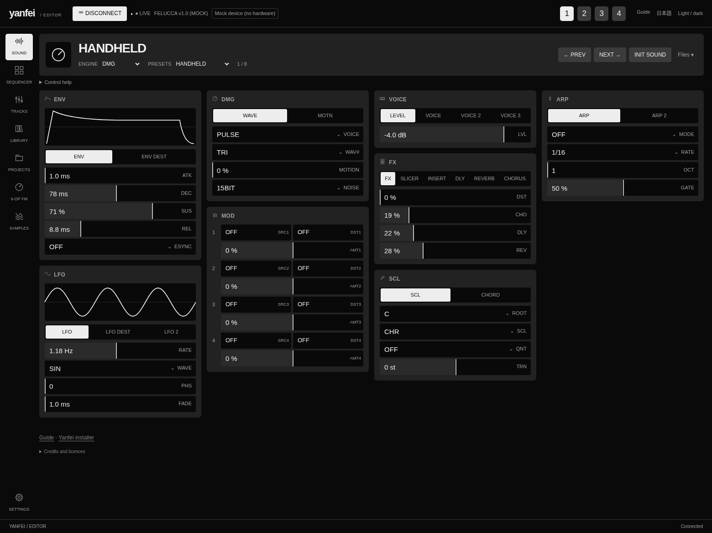

# Yanfei web editor

Use the [editor](../webapp/editor/) in Chrome or Edge.
Connect the FM-1 by USB. Select **Connect** and allow MIDI access.
The top bar shows the firmware version reported by the device.

<figure>

<figcaption>The Sound page, shown with a simulated DMG sound. Select the picture to open it at full size.</figcaption>
</figure>

For the meaning of sound controls, use the [engine guide](ENGINE_GUIDE.md) and
[mode guide](MODE_GUIDE.md).

## Select a track and sound

1. Select a track number in the top bar.
2. Select **Sound** on the left.
3. Select an engine below the sound name.
4. Select a preset, or use **Prev** and **Next**.

**Init sound** resets the current sound. Preset changes replace the sound settings.
Save a sound that you want to keep before you select another preset.

## Change a parameter

Each card contains related controls. Select a tab in the card to see more controls.
For example, the FX card has tabs for the insert, delay, reverb, and chorus.
The PSG chip selector is in the **CHIP** card.

- For a numeric value, drag across its row.
- For a list, select the value and choose an item.
- For a small numeric change, focus the row and use the arrow keys.
- Hold Shift with an arrow key to change the value by ten steps.
- Double-click a numeric row to restore its default value.

The lower-left status area shows the parameter name and value.
The envelope and LFO pictures show approximate shapes from the settings.
They do not show measured audio. Their horizontal scales do not indicate time.

Changes go to the connected device. Save a project on the FM-1 to keep the current work.

## Save or load a sound file

Open **Files**, beside **Init sound**.
Select **Save to file** to download the current sound, or **Load file** to load a file.
**Copy to library** loads the factory version of the selected preset and copies it to the browser library.
Save any edits before you use this command.
The browser library stays on this browser and computer.

## Open another page

| Page | Use |
| --- | --- |
| Sequencer | Edit notes, timing, and automation in the current pattern. |
| Tracks | Set track levels, pan, sends, and mute. |
| Library | Manage the browser library and device user presets. |
| Projects | Save or load project slots and complete backups. |
| 6-OP FM | Import, edit, and send FM6 voices. |
| Samples | Manage available user sample slots. |
| Settings | Set global parameters and supported display settings. |

Use the FM-1 or [emulator](../webapp/try/) for tracker instruments and song sections.
The web sequencer does not expose all tracker fields.
Only supported device features are available.

## Use a smaller screen

On a phone, the page buttons move to a horizontal strip at the top.
Scroll that strip to find more pages. The sound cards form one column.
Scroll the page to reach the other cards.

**Light / dark** changes the editor appearance. It does not change the FM-1 screen.
The language button switches between English and Japanese.

**Try a demo** opens the editor's simulated device. It uses the legacy test engine set.
Connect inside that page to try the controls. It does not produce audio or use the FM-1.

For backup and restore instructions, see the [user guide](USER_GUIDE.md#save-a-complete-backup-to-a-computer).
